# Housing Price MLOps

**Continuous training MLOps platform for housing price prediction:** Airflow decides when to retrain, MLflow champion/challenger promotion, FastAPI and Streamlit serving, deployed on Kubernetes with GitHub Actions and Argo CD.

Every data batch is validated (schema, quality, drift, new categories) before the pipeline decides, with explicit rules, whether a new model is worth training. Candidates are compared against the production model on a fixed holdout through statistical and per-segment gates, and promotion is a change of alias in the MLflow registry that the inference API picks up without being redeployed. The whole system runs on Kubernetes and is synchronized from this repository by Argo CD.

`mlops` `continuous-training` `airflow` `mlflow` `kubernetes` `argocd` `gitops` `fastapi` `streamlit` `prometheus` `grafana` `locust`

---

Proyecto final de **Operaciones de Machine Learning**, Pontificia Universidad Javeriana (Nivel 4: automatización, decisión de reentrenamiento y despliegue GitOps). Este README es el informe del proyecto y la bitácora de su desarrollo. Grupo 1, día martes, API de datos v2.

**Video de sustentación:** https://youtu.be/cBPnmpeW-II

## Resultados en una página

- **Pipeline continuo.** El DAG `housing_pipeline` corre cada 15 minutos en el clúster desde el 22 de noviembre: 79 corridas seguidas en verde hasta el 23 a las 18:15, una por lote, con 12 ciclos completos de la API de datos (6 lotes y un fin de datos con reinicio).
- **Decisiones con razones.** De los 6 lotes del primer ciclo: 5 entrenaron por señales explícitas (línea base, drift, categorías nuevas, crecimiento del volumen), 1 no entrenó por ser pequeño, 3 candidatos se promovieron y 2 se rechazaron por la compuerta de latencia. Desde el segundo ciclo los lotes repetidos se reconocen por su huella SHA-256 y solo vigilan al modelo productivo.
- **Promoción sin redespliegue.** Cada promoción es un cambio de alias en MLflow. Las réplicas de la API cargaron solas las versiones 2, 3 y 4 sin reiniciarse, y lo registraron.
- **Prueba de carga con análisis.** La API se satura en unos 4 RPS por réplica por el costo de CPU de cada predicción. Con la sombra en el 20 % del tráfico y un autoescalado de 2 a 3 réplicas, el throughput subió de ~8 a ~11 RPS con 0 fallos.

## Contenido

1. [Arquitectura](#1-arquitectura)
2. [Bitácora](#2-bitácora)
3. [Datos](#3-datos)
4. [Validación y decisión de entrenamiento](#4-validación-y-decisión-de-entrenamiento)
5. [Modelo, métrica y promoción](#5-modelo-métrica-y-promoción)
6. [Calibración](#6-calibración)
7. [Análisis por lote](#7-análisis-por-lote)
8. [MLflow](#8-mlflow)
9. [Inferencia](#9-inferencia)
10. [Streamlit](#10-streamlit)
11. [CI/CD y GitOps](#11-cicd-y-gitops)
12. [Kubernetes](#12-kubernetes)
13. [Observabilidad y prueba de carga](#13-observabilidad-y-prueba-de-carga)
14. [Lo que no se hizo y por qué](#14-lo-que-no-se-hizo-y-por-qué)
15. [Cómo reproducir](#15-cómo-reproducir)
16. [Equipo](#16-equipo)

## 1. Arquitectura

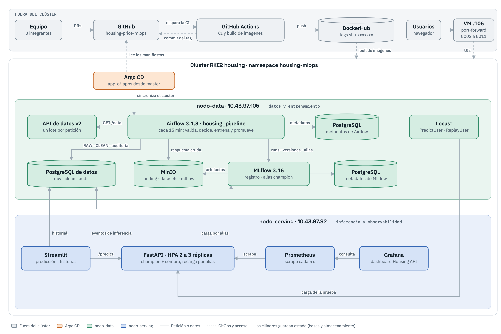

*Arquitectura del sistema. Arriba, el ciclo GitOps: un push a GitHub dispara GitHub Actions, que publica la imagen en DockerHub con el SHA del commit y escribe el tag nuevo en el manifiesto; Argo CD lee el repositorio y sincroniza el clúster. Abajo, el clúster: en `nodo-data` corren la ingesta, el entrenamiento y los datos; en `nodo-serving`, la inferencia y la observabilidad.*

**Versión interactiva:** [crissebasbol.github.io/housing-price-mlops/arquitectura.html](https://crissebasbol.github.io/housing-price-mlops/arquitectura.html) (fuente en [`docs/arquitectura.html`](docs/arquitectura.html)). Cada componente muestra qué hace, sus recursos y con quién habla, y cuatro recorridos animan un cambio en Git, un lote de datos, una predicción y la prueba de carga paso a paso. La imagen de arriba sale de esa misma página.

| Componente | Nodo | Rol |
|---|---|---|
| API de datos v2 | data | Imagen del curso desplegada en el clúster; entrega un lote por petición |
| Airflow 3.1.8 | data | Orquesta ingesta, validación, decisión de entrenamiento, registro y promoción (LocalExecutor: las tareas corren en el scheduler) |
| PostgreSQL de datos | data | Schemas `raw`, `clean` y `audit`, con un rol por consumidor |
| MinIO | data | `landing` (respuestas crudas de la API), `datasets` (archivos de trabajo y muestra de replay) y `mlflow` (artefactos) |
| MLflow 3.16 + PostgreSQL | data | Experimentos, registro de modelos con alias y artefactos (servidos por el propio MLflow) |
| Locust | data | Prueba de carga contra la API, en otro nodo para no quitarle CPU |
| FastAPI | serving | Inferencia con el champion de MLflow y el challenger en sombra; recarga por alias sin redespliegue |
| Streamlit | serving | Predicción con explicación, historial de lotes y estado del modelo |
| Prometheus + Grafana | serving | Métricas de la API, de la API de datos y de los contenedores (cAdvisor) |
| GitHub Actions + DockerHub | fuera | CI, construcción y publicación de imágenes con tag por commit |
| Argo CD | clúster | Sincroniza los manifiestos del repositorio con el clúster (app-of-apps) |

**Infraestructura.** Tres VMs de la universidad: la .106 (no es nodo) tiene Rancher, `kubectl`, el CLI de Argo y los port-forward hacia las interfaces; la .105 (`nodo-data`, todos los roles de RKE2) y la .92 (`nodo-serving`, worker) forman el clúster RKE2 `housing`, con unos 4 CPU y 16 GB cada una. Cada workload elige su nodo con `nodeSelector` sobre la etiqueta `mlops/tier`.

| Puerto en la .106 | Interfaz | Puerto en la .106 | Interfaz |
|---|---|---|---|
| 8001 | Rancher | 8007 | Streamlit |
| 8002 | Airflow | 8008 | Grafana |
| 8003 | MLflow | 8009 | Prometheus |
| 8004 | MinIO | 8010 | Locust |
| 8005 | API de inferencia | 8011 | API de datos |
| 8006 | Argo CD | | |

**Recorrido de un lote.** Cada 15 minutos Airflow pide un lote a la API de datos y guarda la respuesta tal cual en MinIO y en RAW. Valida el esquema, la calidad, las categorías nuevas y el drift; pasa las filas válidas a CLEAN y decide si entrenar. Si entrena, registra el candidato en MLflow, lo compara con el champion sobre el mismo holdout y, si pasa las compuertas, mueve el alias `champion`. La API revisa los alias cada 30 segundos y carga la versión nueva sin reiniciarse. Cada paso deja su parte en la tabla de auditoría, que Streamlit muestra.

## 2. Bitácora

### 17 de noviembre: punto de partida

Leímos el enunciado y revisamos lo que ya teníamos de proyectos anteriores. Del proyecto 2 reutilizamos la infraestructura: un clúster RKE2 administrado con Rancher, con un nodo para datos y entrenamiento y otro para inferencia y observabilidad. También la base de Airflow con Helm, MLflow con PostgreSQL y MinIO, y la instrumentación de FastAPI. Del taller 6 tomamos el flujo de GitHub Actions que publica en DockerHub y actualiza el tag en Git para que Argo CD sincronice.

Lo nuevo de este nivel es que el sistema debe **decidir**: si un lote justifica entrenar, si el candidato es mejor que el modelo productivo y cuándo cambiar de versión sin tocar la API.

### 17 al 21 de noviembre: un plan completo antes del código

Antes de escribir una línea de código armamos un plan con todo lo que había que construir:

- cada requisito del enunciado asignado a un componente;
- el diseño del DAG y de sus bifurcaciones;
- las tablas de RAW, CLEAN y auditoría;
- las reglas de calidad, de entrenamiento y de promoción con sus umbrales;
- los recursos de cada contenedor;
- las evidencias que debía dejar cada etapa;
- un cronograma con el orden en que se recorta si falta tiempo.

En ese plan estudiamos varias estrategias para decidir si un modelo nuevo es mejor, tomando como referencia cómo lo hace la industria con el esquema *champion/challenger*:

| Estrategia | Decisión | Por qué |
|---|---|---|
| Comparar solo una métrica global | Descartada | Una mejora en promedio puede ocultar caídas en segmentos (por ejemplo, las casas más caras) |
| Holdout fijo que nunca se usa para entrenar | Adoptada | Champion y candidato se comparan siempre sobre los mismos datos, aunque el split de entrenamiento crezca |
| Compuertas: significancia, segmentos, comportamiento, latencia y tamaño | Adoptada | Es la evaluación offline previa al despliegue que usan los equipos de MLOps |
| Explicaciones con SHAP | Adoptada | Como artefacto de cada modelo y para comparar en qué variables se apoya cada versión |
| Modelo en sombra (*shadow*) | Adoptada | El candidato predice en paralelo sin afectar la respuesta, y se mide su latencia y su diferencia con el productivo |
| Rollback por alias | Adoptada | Volver al modelo anterior es un cambio de alias en MLflow, sin redespliegue |
| Endpoint de feedback con el precio real | Adoptada, como complemento | Casi no habrá feedback de usuarios; la etiqueta real llega con los lotes siguientes, que son la fuente principal de evaluación |
| Promoción solo manual por endpoints | Descartada | El enunciado pide que el pipeline promueva por una regla explícita; lo manual queda para operar (rollback, recarga) |
| Canary con Argo Rollouts, pruebas A/B, namespaces de staging | Descartadas | Sin usuarios reales no son significativas, y versionar el modelo en Git contradice que MLflow sea la fuente de verdad |

### 21 de noviembre: exploración de la API de datos y decisiones de diseño

**La API de datos.** Antes de diseñar las tablas levantamos la imagen `cristiandiaz13/mlops-puj:data-api-pf-v2` en local y pedimos los lotes completos del grupo 1. Así no consumimos lotes de la instancia compartida. Leyendo su código confirmamos que:

- avanza un lote por petición, no por tiempo;
- entrega 6 lotes y luego responde HTTP 400 con el mensaje "Ya se recolectó toda la información minima necesaria";
- el reinicio vuelve a entregar exactamente los mismos lotes.

**Los lotes no son aleatorios.** Cada uno es un corte deliberado del dataset:

| Lote | Filas | Qué lo distingue |
|---|---|---|
| 0 | 73.784 | En venta, precio hasta 300 mil USD, casas de 1.500 pies² o más |
| 1 | 94.551 | En venta, precio hasta 300 mil USD, casas de menos de 1.500 pies² |
| 2 | 230.366 | Todas vendidas (`sold`, categoría nueva), misma distribución numérica |
| 3 | 4.055 | Solo Massachusetts, lote pequeño |
| 4 | 320.696 | Precio entre 300 y 500 mil USD, rango nunca visto |
| 5 | 361.457 | Precio desde 500 mil USD, con valores extremos hasta 515 millones |

No hay nulos ni filas duplicadas, pero sí valores absurdos: precios de 1 USD, casas de 1,5 millones de pies², 444 habitaciones. Midiendo el cambio de distribución de cada lote frente a lo acumulado (PSI y Kolmogorov-Smirnov), el lote 1 cambia por completo el tamaño de las casas, el lote 2 no cambia nada numérico pero trae un estado nuevo, y los lotes 4 y 5 desplazan por completo el precio.

**Decisiones que salen de esa exploración:**

- **API de datos propia dentro del clúster.** La instancia publicada por el docente es compartida: si otro equipo pide lotes del mismo grupo, avanza nuestro contador. Con una instancia propia la secuencia es reproducible y la API de datos queda, como todos los componentes, en Kubernetes.
- **MAPE como métrica prioritaria.** Con precios entre 10 mil y 20 millones de USD, el MAE en dólares queda dominado por las casas más caras y el RMSE por unos pocos extremos. El error porcentual se puede comparar entre una casa de 100 mil y una de 5 millones. MAE y R² quedan como salvaguardas.
- **Reglas de calidad por fila** (por ejemplo, precio entre 10 mil y 20 millones de USD, 1 a 20 habitaciones). Las filas inválidas quedan en RAW con su motivo y no pasan a CLEAN.
- **Fin de datos: reiniciar y seguir leyendo.** Cuando la API se agota, el pipeline la reinicia. Los lotes repetidos se reconocen por su huella SHA-256 y no se reingieren. Se usan para vigilar al modelo productivo sobre filas que nunca vio.
- **Promoción por compuertas, no solo por una métrica.** Un candidato reemplaza al productivo solo si mejora el MAPE en al menos 1 % sobre un holdout fijo que ningún modelo usa para entrenar, si la mejora es estadísticamente significativa, si no empeora en segmentos importantes y si cumple un presupuesto de latencia y tamaño.

### 21 de noviembre: la simulación encuentra dos problemas antes de desplegar

Con el paquete `housing_ml` listo (esquema, calidad, drift, decisión, modelo y compuertas), corrimos la lógica completa fuera del clúster sobre los 6 lotes reales ([sección 6](#6-calibración)). La primera corrida rechazó **todos** los candidatos y nos dejó dos hallazgos:

1. **Latencia.** Ningún modelo cumplía el presupuesto de 50 ms por predicción: el p95 iba de 60 a 328 ms. Perfilando una predicción encontramos dos culpables: `TargetEncoder.transform` de scikit-learn tardaba unos 60 ms por fila con ~100 mil categorías de `brokered_by`, y HistGradientBoosting con varios hilos perdía 18 a 38 ms coordinando OpenMP para una sola fila. Escribimos `MappedTargetEncoder` (entrena con el `TargetEncoder` de scikit-learn y al servir busca en diccionarios, con una prueba que verifica los mismos valores) y servimos con 1 hilo. El p95 bajó a 10-27 ms.
2. **Segmentos definidos con el target.** Con la latencia resuelta, los lotes 4 y 5 se rechazaban porque el candidato empeoraba en la banda de precio menor a 300 mil, aunque el MAPE total mejoraba 28 %. Más capacidad del modelo no lo arreglaba. La causa: esa banda está definida con el precio real, y un modelo entrenado con un rango de precios más corto siempre parece mejor en ella. La compuerta de segmentos quedó solo con variables disponibles al predecir (`status`, estado, tamaño de la casa), y la banda de precio se registra como diagnóstico que no bloquea.

### 22 de noviembre: clúster desde cero y plataforma de datos

Las VMs se habían limpiado al terminar el proyecto 2, así que montamos todo de nuevo: Rancher en la .106, el clúster RKE2 creado desde su interfaz, `local-path` como StorageClass, las etiquetas `mlops/tier` y Argo CD (todo con los scripts de [`cluster/`](cluster/README.md)). Después la plataforma de datos: PostgreSQL con los schemas y roles, MinIO con sus buckets y usuarios, MLflow con su propio PostgreSQL y la API de datos.

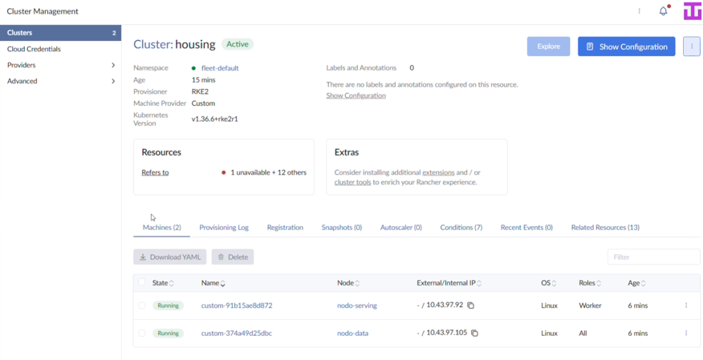

*Rancher con el clúster `housing` en estado Active: `nodo-data` (.105, todos los roles) y `nodo-serving` (.92, worker) en Running.*

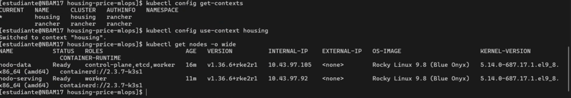

*`kubectl get nodes -o wide` desde la .106: `nodo-data` (control-plane, etcd, worker) y `nodo-serving` (worker) en Ready, Kubernetes v1.36.6+rke2r1.*

El primer problema apareció enseguida: el Job que crea los buckets y usuarios de MinIO moría por falta de memoria con 128 Mi. Lo vimos en los eventos del pod y le subimos el límite a 512 Mi.

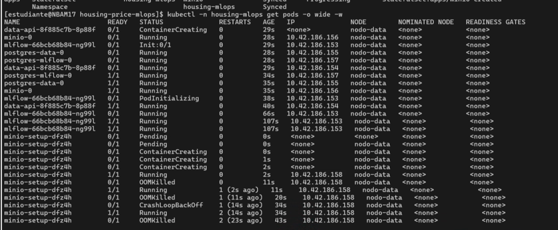

*Primera sincronización de la plataforma: bases, MinIO, MLflow y API de datos llegan a Running; el Job `minio-setup` muere por `OOMKilled` con 128 Mi de límite. Se corrigió en el PR #13.*

### 22 de noviembre: Airflow, primero en Docker y después en el clúster

Antes de llevar el DAG al clúster lo corrimos de punta a punta en Docker, contra los mismos servicios (PostgreSQL con los scripts de inicio, MinIO, MLflow con nuestra imagen y la API de datos), con un `airflow dags test` por lote ([sección 6](#6-calibración)). Salió la misma historia que en la simulación, y tres errores de empaquetado que no habríamos visto con pruebas unitarias: Airflow no encontraba el paquete `pipeline`, leía `pipeline/database.py` como si fuera un DAG y el script de roles de la base había perdido el permiso de ejecución en Git.

Airflow se despliega con el chart oficial 1.22.0 desde Argo CD, como app *multi-source*: el chart viene del repositorio de Helm y los valores de este repositorio. Las migraciones y la creación del usuario son hooks de Argo, y la base de metadatos tiene una ola anterior para existir antes que ellas.

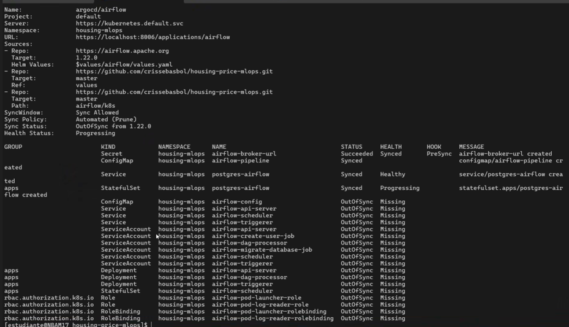

*Primera sincronización de `airflow`: el hook PreSync y la ola -1 (PostgreSQL de metadatos y ConfigMap del pipeline) se aplican primero; el resto del chart espera en OutOfSync.*

El despliegue destapó otros tres problemas, todos de infraestructura:

- **Disco.** El api-server de Airflow fue desalojado por `DiskPressure`: `/var` era un volumen de 15 GB y las imágenes del clúster ocupaban 9 GB. El disco de cada VM tenía 150 GB, pero la partición solo usaba 58. Lo ampliamos en caliente (`growpart`, `pvresize`, `lvextend`) en las tres VMs.
- **Memoria de MLflow.** MLflow murió por `OOMKilled` (2 GiB) mientras Airflow descargaba un modelo. MLflow 3.16 arranca por defecto 7 procesos para ejecutar *jobs* de funciones de GenAI que no usamos; medido en Docker, llegaban a 2,1 GB. Con `MLFLOW_SERVER_ENABLE_JOB_EXECUTION=false` quedaron 6 procesos y, en el clúster, 584 Mi.
- **Latencia en el clúster.** El primer lote se entrenó bien (MAPE 23,3 % en holdout), pero la compuerta de latencia lo rechazó: 58,5 ms frente al máximo de 50, calibrado en un portátil. Los nodos del clúster resultaron unas 3,8 veces más lentos. Subimos el presupuesto a 150 ms, con margen sobre los ~110 ms que proyectaba el modelo más grande.

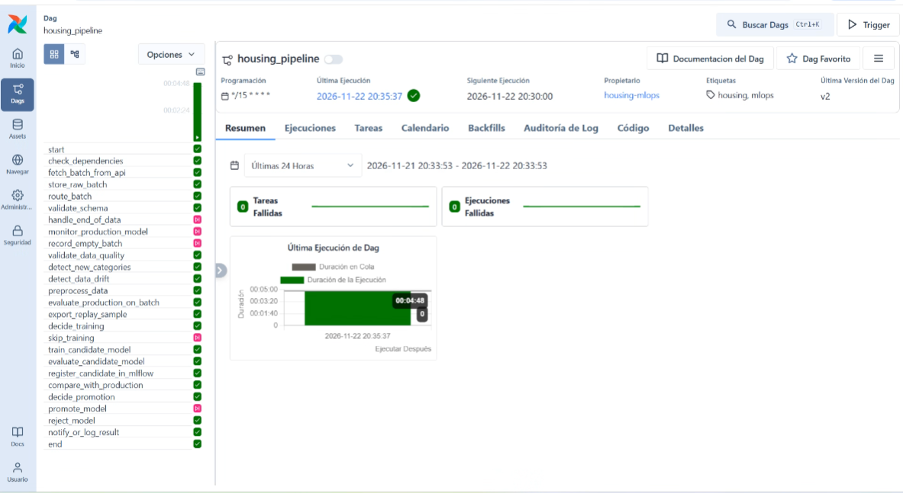

*La primera corrida en el clúster (lote 0): ingesta, validación y entrenamiento en verde; la promoción toma la rama `reject_model` por la compuerta de latencia.*

### 22 y 23 de noviembre: la API y el ciclo continuo

Con la API desplegada en `nodo-serving` despausamos el DAG a las 23:24. El lote 1 entrenó una línea base (no había champion) y se promovió como versión 2; la API la cargó sola a las 23:27, sin reiniciar ningún pod. Siguieron las versiones 3 (23:31) y 4 (23:51). La versión 5, entrenada con el lote 5, tenía mejor MAPE que el champion (20,9 % frente a 28,3 %) pero se rechazó por latencia: 152,4 ms frente a 150 ([sección 7](#7-análisis-por-lote)). Al agotarse la API, el pipeline la reinició y desde entonces procesa lotes repetidos que solo vigilan al champion.

### 23 de noviembre: Streamlit, observabilidad y carga

Desplegamos Streamlit, Prometheus, Grafana y Locust. La primera prueba de carga mostró que la API se estancaba en ~8 RPS con la CPU de cada réplica en su límite. Con esa evidencia hicimos tres ajustes por GitOps: la sombra solo en el 20 % del tráfico en vivo, sondas de salud con más margen y un autoescalado de 2 a 3 réplicas por CPU. La segunda prueba subió el throughput a ~11 RPS ([sección 13](#13-observabilidad-y-prueba-de-carga)).

## 3. Datos

Todos los datos del proyecto viven en una base PostgreSQL (`housing`) con tres schemas separados y un rol por consumidor. MLflow y Airflow tienen cada uno su propia instancia de PostgreSQL, separada de los datos del dominio.

| Schema | Tabla | Qué guarda |
|---|---|---|
| `raw` | `batches` | Una fila por **petición** a la API de datos, incluidas las repetidas y el fin de datos: ciclo, número de lote, respuesta HTTP, `outcome` (`new`, `duplicate`, `end_of_data`, `empty`), cantidad de filas, huella SHA-256 de los datos, a quién repite, ruta en el landing y estado del procesamiento |
| `raw` | `properties` | Cada fila del lote **sin modificar** (`payload` en JSONB), con su `row_hash`, `quality_status` y los motivos de rechazo |
| `raw` | `inference_events`, `inference_feedback` | Cada inferencia de la API (entrada, predicción, versión, latencia, sombra, estado y error) y el precio real que llega por `/feedback` |
| `clean` | `properties` | Filas válidas normalizadas, con `row_hash` (el mismo de RAW), lote y ciclo de origen, partición (`train`, `val`, `test`, `holdout`) y versión del preprocesamiento |
| `audit` | `batch_runs` | Una fila por ingreso con lo que pasó en cada etapa: esquema, calidad, categorías nuevas, drift, decisión de entrenar y su razón, candidato, compuertas, promoción y su razón, métricas y estado final |
| `audit` | `model_evaluations`, `model_actions` | Cada métrica de cada modelo en cada conjunto (holdout, lote nuevo, monitoreo, segmentos) y cada recarga o rollback de la API |

**Por qué así:**

- **RAW reconstruye cada ejecución.** Además de la tabla, la respuesta de la API se guarda tal cual, comprimida, en MinIO (`s3://landing/cycle=<c>/batch=<n>/<dag_run_id>.json.gz`). Con el `ingestion_id` se sabe qué llegó, cuándo, en qué ciclo y con qué huella.
- **CLEAN es trazable a RAW** por `row_hash` e `ingestion_id`. RAW y CLEAN son schemas y no bases distintas porque la trazabilidad es un join, y PostgreSQL no une tablas de bases diferentes.
- **Roles con el mínimo permiso.** `airflow_etl` escribe RAW, CLEAN y auditoría; `api_writer` solo inserta eventos de inferencia y acciones del modelo; `app_reader` solo lee (Streamlit y Grafana). Las contraseñas viven en Secrets de Kubernetes, nunca en el repositorio.

**Cómo se evita reprocesar un lote (RF1):**

- **Huella del contenido.** Un lote cuya huella SHA-256 ya existe se registra como `duplicate` en `raw.batches`, con `duplicate_of`, pero no inserta filas ni entrena. Así funciona la lectura continua después del fin de datos.
- **Reintentos idempotentes.** Si `fetch_batch_from_api` se reintenta dentro de la misma ejecución, reutiliza la respuesta ya guardada en el landing en vez de pedir otro lote: cada petición a la API consume uno.
- **Recuperación controlada.** Si una ejecución descargó un lote y falló antes de terminar, la siguiente lo reprocesa desde el landing (hasta 3 intentos; después queda en cuarentena y se sigue).
- **Sin consumir lotes con el sistema caído.** `check_dependencies` verifica PostgreSQL, MinIO, MLflow y la API de datos antes de pedir un lote.

Del primer ciclo entraron 1.084.909 filas a RAW: 1.572 se rechazaron por calidad y 1.083.337 pasaron a CLEAN.

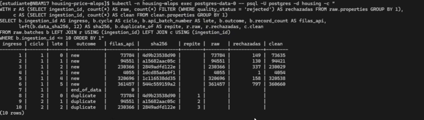

*`raw.batches` con los conteos de RAW y CLEAN de los ingresos 1 a 10: filas que entregó la API, los primeros 12 caracteres de la huella SHA-256, filas en RAW, rechazadas y en CLEAN (por ejemplo, ingreso 6: 361.457 en RAW, 797 rechazadas y 360.660 en CLEAN). El ingreso 7 es el fin de datos, sin filas. Los ingresos 8 a 10 tienen la misma huella que los ingresos 1 a 3 (columna `repite`) y no insertan filas.*
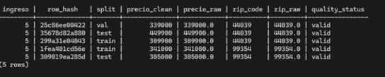

*Cinco filas del ingreso 5 en CLEAN unidas a su fila original en RAW por `row_hash`: la partición asignada (train, val o test), el precio y el código postal normalizados (RAW guarda el `zip_code` tal como llegó, `44039.0`; CLEAN lo guarda como `44039`) y `quality_status=valid`.*

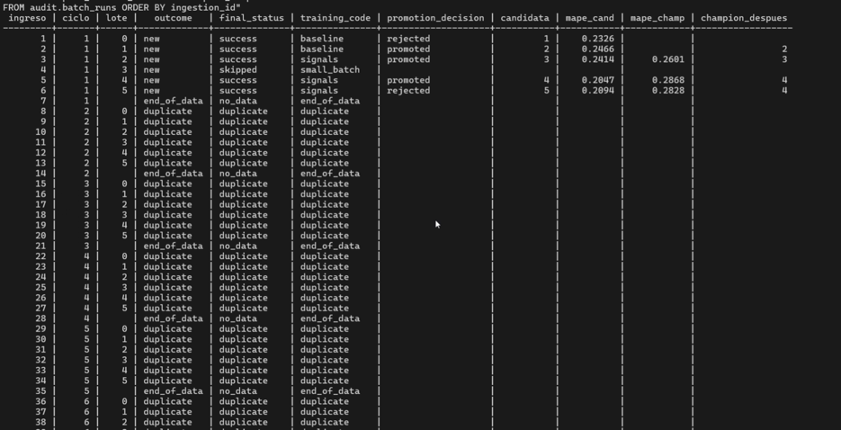

*`audit.batch_runs` en el clúster: ingresos 1 a 38. El ciclo 1 con sus decisiones (línea base rechazada, promociones de las versiones 2, 3 y 4, lote pequeño sin entrenar, versión 5 rechazada), el fin de datos (ingreso 7) y desde el ciclo 2 los lotes repetidos (`duplicate`) con su fin de datos al cerrar cada ciclo.*

## 4. Validación y decisión de entrenamiento

### Reglas de calidad por fila

Viven en `housing_ml` y las usan igual el pipeline y la API (los mismos rangos validan la entrada de `/predict`):

| Campo | Fila válida |
|---|---|
| `price` | 10.000 a 20.000.000 USD |
| `house_size` | 100 a 30.000 pies² |
| `acre_lot` | 0 a 1.000 |
| `bed`, `bath` | 1 a 20 |
| `prev_sold_date` | entre 1900 y la fecha de ingesta, o vacía |
| `status`, `state`, `city` | no vacíos (valores nuevos se aceptan y se reportan) |
| `zip_code` | convertible a 5 dígitos |

Una fila que no cumple queda en RAW con `quality_status=rejected` y sus motivos, y no pasa a CLEAN.

### Validaciones del lote

| Tarea | Qué mide |
|---|---|
| `validate_schema` | Columnas esperadas, faltantes y nuevas, y tipos. Resultado `ok`, `adapted` (columnas extra ignoradas, tipos convertibles) o `invalid` |
| `validate_data_quality` | Nulos, duplicados, filas rechazadas por regla y por motivo, extremos por IQR |
| `detect_new_categories` | Valores de `status`, `state`, `city`, `zip_code` y `brokered_by` nunca vistos en el acumulado, con el % de filas del lote que los traen |
| `detect_data_drift` | PSI (10 cuantiles) y Kolmogorov-Smirnov en `price`, `house_size`, `bed`, `bath` y `acre_lot` frente a lo acumulado en CLEAN |
| `evaluate_production_on_batch` | MAPE del champion sobre las filas válidas del lote nuevo, antes de entrenar: la señal de degradación |

Cada reporte queda en `audit.batch_runs` (JSON) y como artefacto del run de MLflow cuando hay entrenamiento.

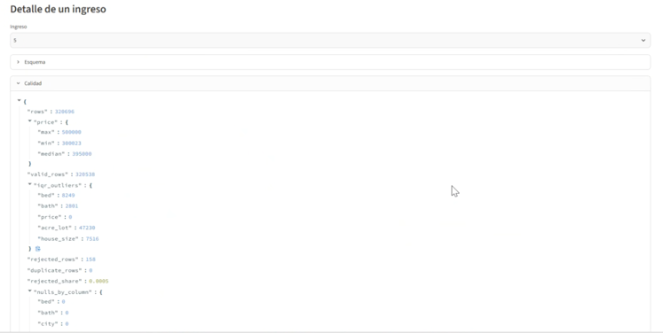

*Reporte de calidad del ingreso 5 (lote 4) en Streamlit: 320.696 filas con precio entre 300.023 y 500.000 USD (mediana 395.000), 320.538 válidas, 158 rechazadas (0,05 %), 0 duplicados, extremos por IQR por variable y nulos por columna.*

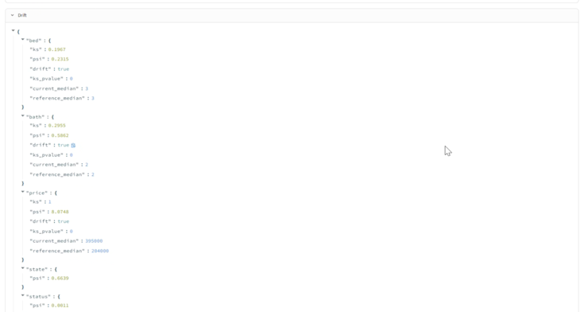

*Reporte de drift del mismo ingreso frente al acumulado: `bed` (PSI 0,23, KS 0,20), `bath` (PSI 0,59, KS 0,30) y `price` (PSI 8,07, KS 1, mediana de 204.000 a 395.000 USD) con `drift: true`; la distribución de `state` y `status` casi no cambia (PSI 0,06 y 0,001).*

### La decisión de entrenar

`decide_training` aplica estas reglas en orden (umbrales en `housing_ml/decision.py`):

1. **No entrena** si el esquema es inválido, si más del 20 % de las filas se rechazó, o si el lote es pequeño: menos de 10.000 filas válidas **o** menos del 5 % del acumulado válido. Sus filas quedan en CLEAN para el siguiente entrenamiento.
2. **Entrena una línea base** si no hay champion.
3. **Entrena** si se cumple al menos una señal:
   - **drift:** PSI mayor a 0,2 en alguna variable numérica;
   - **categorías nuevas:** al menos 2 % de las filas del lote con un `status` o un estado nunca vistos;
   - **volumen:** el acumulado válido creció al menos 20 % desde el último entrenamiento;
   - **degradación:** el MAPE del champion en el lote nuevo es al menos 1,10 veces su MAPE de referencia (el del holdout cuando se promovió);
   - **drift de inferencias:** PSI mayor a 0,2 en las entradas reales que recibió la API (de Streamlit y de clientes, sin la prueba de carga), con al menos 500 eventos.
4. Si ninguna señal se cumple, **no entrena** ("sin cambios relevantes").

La decisión nunca depende de la hora ni de cuántos lotes van: depende de qué trae el lote. La razón queda escrita en español en la auditoría (`training_reason`) y como tag del run en MLflow, con la lista de señales.

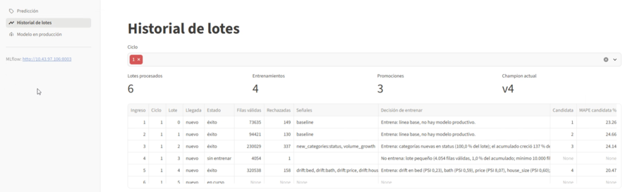

*Historial del ciclo 1 en Streamlit: señales y razón de cada decisión. Línea base sin modelo productivo (ingresos 1 y 2), categoría nueva `sold` en el 100 % del lote y acumulado que crece 137 % (ingreso 3), lote pequeño de 4.054 filas que no entrena (ingreso 4) y drift en `bed`, `bath`, `price` y `house_size` (ingreso 5, PSI del precio 8,07).*

### Robustez ante categorías nuevas

El lote 3 trae un estado que el modelo nunca vio (Massachusetts) y todos los lotes traen ciudades, códigos postales y agencias nuevas. Las variables categóricas se codifican con un *target encoding* que asigna la media global a cualquier valor desconocido, así que una categoría nueva nunca rompe la predicción. Se comprueba en tres lugares: la compuerta de comportamiento (G5) predice una fila con categorías inventadas antes de promover; la API cuenta las categorías que el champion no conoce (`unknown_category_total`); y Grafana las muestra durante la prueba de carga ([sección 13](#13-observabilidad-y-prueba-de-carga)).

## 5. Modelo, métrica y promoción

### Modelo

| Parte | Decisión | Por qué |
|---|---|---|
| Algoritmo | `HistGradientBoostingRegressor` | Datos tabulares de un millón de filas: entrena en segundos, maneja nulos y admite restricciones monótonas |
| Target | `log1p(price)` con `TransformedTargetRegressor` | Los precios van de 10 mil a 20 millones; en escala logarítmica el error relativo pesa igual en toda la escala, en línea con el MAPE |
| Restricciones | Monótona creciente en `house_size` y `bath` | Una casa más grande nunca debe valer menos; la compuerta G5 lo verifica |
| Numéricas | `bed`, `bath`, `acre_lot`, `house_size`, `prev_sold_year` | Se deriva el año de la venta previa; los nulos se permiten |
| Categóricas | `status`, `state`, `city_state`, `zip_code`, `zip3`, `brokered_by` | Codificadas con `MappedTargetEncoder` (sección 2): mismos valores que el `TargetEncoder` de scikit-learn, sin su costo al servir |
| Hiperparámetros | `max_iter=1500` con *early stopping*, `max_leaf_nodes=127`, `min_samples_leaf=50`, `l2_regularization=1.0` | Calibrados en la simulación: con 500 iteraciones los modelos llegaban al tope |

Todo el preprocesamiento va dentro del pipeline del modelo: la API le pasa los campos crudos y el modelo deriva sus variables igual que en el entrenamiento. El paquete `housing_ml` se instala en las imágenes de Airflow y de la API con las mismas versiones de scikit-learn (1.8.0) y numpy (2.4.2).

**Partición estable.** Cada fila va a `train` (70 %), `val` (10 %), `test` (10 %) o `holdout` (10 %) según su `row_hash`. Una fila cae siempre en la misma partición, aunque llegue en otro lote. El holdout nunca se usa para entrenar ni para ajustar: solo para comparar champion y candidato y para monitorear.

**Métrica prioritaria: MAPE** (justificada en la [sección 2](#21-de-noviembre-exploración-de-la-api-de-datos-y-decisiones-de-diseño)). Se registran también MdAPE, MAE, RMSE y R² en las cuatro particiones.

### Compuertas de promoción

Champion y candidato se evalúan sobre **el mismo** holdout en el momento de comparar (el champion se recalcula, así las métricas son comparables aunque el holdout crezca). El candidato se promueve solo si pasa todas:

| | Compuerta | Regla (`housing_ml/gates.py`) |
|---|---|---|
| G1 | Holdout total | MAPE del candidato al menos 1 % menor; MAE no más de 1 % mayor; R² no más de 0,01 menor |
| G2 | Significancia | Bootstrap pareado (1.000 muestras, hasta 50 mil filas) de la diferencia de error porcentual: el intervalo de 95 % queda por debajo de 0 |
| G3 | Datos recientes | En el holdout de los lotes nuevos desde el último entrenamiento, el candidato no es peor |
| G4 | Segmentos | En `status`, los 10 estados con más filas y la banda de tamaño, con al menos 1.000 filas, el MAPE no empeora más de 5 %. La banda de precio se registra como diagnóstico |
| G5 | Comportamiento | Predicciones finitas y positivas; como máximo 1 % fuera de 5 mil a 50 millones; +20 % de `house_size` nunca baja el precio; una fila con categorías desconocidas predice sin error |
| G6 | Presupuesto de servicio | p95 de una predicción de una fila de máximo 150 ms (200 llamadas, con 1 hilo, como la API) y modelo serializado de máximo 200 MB |

Sin champion solo aplican G5 y G6. **Promover** es mover alias en el registro de MLflow: `previous_champion` pasa a apuntar al champion actual y `champion` al candidato. `challenger` siempre apunta al último candidato, promovido o no. Cada versión lleva tags con su ingreso, su decisión, su razón y su MAPE de holdout.

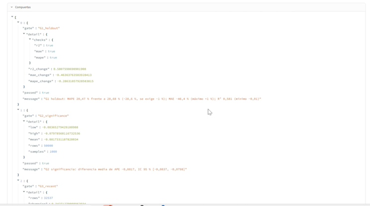

*Compuertas del ingreso 5 (v4 frente a v3) en el detalle de Streamlit: G1 con MAPE de 20,47 % frente a 28,68 % (-28,6 %; se exige al menos -1 %), MAE -46,4 % y R² de 0,581; G2 con una diferencia media de error porcentual de -0,082 e intervalo de 95 % entre -0,084 y -0,080, sobre 50.000 filas y 1.000 muestras bootstrap; G3 sobre las 32.537 filas recientes del holdout.*

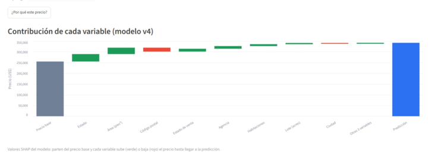

*Explicación de una predicción del modelo v4 en Streamlit: valores SHAP desde el precio base hasta la predicción. El estado, el área, el estado de venta, la agencia y las habitaciones suben el precio; el código postal y la ciudad lo bajan.*

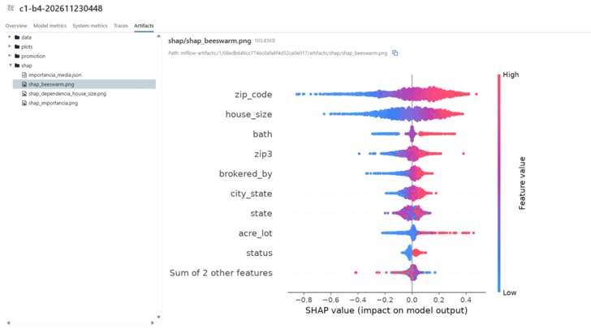

*Artefacto SHAP del run `c1-b4` (versión 4, champion) en MLflow: el código postal y el tamaño de la casa son las variables con más efecto; para `bath` y `house_size` los valores altos (rojo) siempre suben el precio, como exige la restricción monótona.*

## 6. Calibración

Antes de llevar las reglas a Airflow corrimos el pipeline fuera del clúster con `scripts/simulate_batches.py`. Aplica la misma lógica del paquete `housing_ml` (esquema, calidad, drift, decisión de entrenamiento y compuertas), sin Airflow ni MLflow, sobre los 6 lotes descargados de nuestra API de datos. Los recorre dos veces, como cuando el pipeline reinicia la API al agotarse. Sirve para calibrar los umbrales y para medir el tiempo y la memoria del entrenamiento.

### Primera corrida (21 de noviembre)

WSL2 (Ubuntu) en un portátil con Intel Core i7-1355U y 32 GB de RAM; CPython 3.12.16 y scikit-learn 1.8.0.

```bash
uv run python scripts/simulate_batches.py --batches-dir data/batches --out data/simulation
```

| Ciclo | Lote | Filas | Válidas | Entrenamiento | Señales | Promoción | MAPE candidato | MAPE productivo | Entrenamiento (s) |
|---|---|---|---|---|---|---|---|---|---|
| 1 | 0 | 73784 | 73635 | baseline | baseline | rejected | 23,26 % | - | 2.4 |
| 1 | 1 | 94551 | 94421 | baseline | baseline | rejected | 24,66 % | - | 10.2 |
| 1 | 2 | 230366 | 230029 | baseline | baseline | rejected | 24,21 % | - | 15.3 |
| 1 | 3 | 4055 | 4054 | small_batch | - | - | - | - | - |
| 1 | 4 | 320696 | 320538 | baseline | baseline | rejected | 20,43 % | - | 32.7 |
| 1 | 5 | 361457 | 360660 | baseline | baseline | rejected | 20,84 % | - | 74.2 |
| 2 | 0 | 73784 | - | - | - | - | - | - | - |
| 2 | 1 | 94551 | - | - | - | - | - | - | - |
| 2 | 2 | 230366 | - | - | - | - | - | - | - |
| 2 | 3 | 4055 | - | - | - | - | - | - | - |
| 2 | 4 | 320696 | - | - | - | - | - | - | - |
| 2 | 5 | 361457 | - | - | - | - | - | - | - |

El MAPE candidato se mide sobre el holdout fijo; el log muestra además el MAPE de validación. La memoria pico del proceso llegó a 2.107 MB al entrenar con el lote 5.

<details>
<summary>Log de la corrida</summary>

```text
=== ciclo 1, lote 0: 73784 filas
Esquema ok; válidas 73635, rechazadas 149 {'price_out_of_range': 65, 'house_size_out_of_range': 25, 'acre_lot_out_of_range': 64, 'bed_out_of_range': 1, 'bath_out_of_range': 1}
PSI: {}
Nuevas: {}
Entrena: línea base, no hay modelo productivo.
Entrenado en 2 s con 51397 filas, 102 iteraciones; val MAPE 23,43 %
  OK  G5 comportamiento: 0,00 % fuera de rango plausible, 0 predicciones bajan al aumentar house_size 20 %, categorías desconocidas sin error
  NO  G6 presupuesto: p95 de una predicción 60,5 ms (máximo 50), modelo de 2,3 MB (máximo 200)
  diagnóstico price_band=<300k: 23,39 % frente a -
Se rechaza: G6 presupuesto: p95 de una predicción 60,5 ms (máximo 50), modelo de 2,3 MB (máximo 200).

=== ciclo 1, lote 1: 94551 filas
Esquema ok; válidas 94421, rechazadas 130 {'price_out_of_range': 71, 'acre_lot_out_of_range': 57, 'bed_out_of_range': 2}
PSI: {'price': 0.3382, 'house_size': 8.3199, 'bed': 1.1151, 'bath': 1.0619, 'acre_lot': 0.1294}
Nuevas: {'status': 0.0, 'state': 0.0, 'city': 0.0521, 'zip_code': 0.102, 'brokered_by': 0.2147}
Entrena: línea base, no hay modelo productivo.
Entrenado en 10 s con 117309 filas, 265 iteraciones; val MAPE 24,59 %
  OK  G5 comportamiento: 0,00 % fuera de rango plausible, 0 predicciones bajan al aumentar house_size 20 %, categorías desconocidas sin error
  NO  G6 presupuesto: p95 de una predicción 81,1 ms (máximo 50), modelo de 5,0 MB (máximo 200)
  diagnóstico price_band=<300k: 24,75 % frente a -
Se rechaza: G6 presupuesto: p95 de una predicción 81,1 ms (máximo 50), modelo de 5,0 MB (máximo 200).

=== ciclo 1, lote 2: 230366 filas
Esquema ok; válidas 230029, rechazadas 337 {'price_out_of_range': 159, 'house_size_out_of_range': 8, 'acre_lot_out_of_range': 168, 'bed_out_of_range': 1, 'bath_out_of_range': 2}
PSI: {'price': 0.0006, 'house_size': 0.0016, 'bed': 0.0023, 'bath': 0.0013, 'acre_lot': 0.0044}
Nuevas: {'status': 1.0, 'state': 0.0, 'city': 0.0235, 'zip_code': 0.0412, 'brokered_by': 0.1016}
Entrena: línea base, no hay modelo productivo.
Entrenado en 15 s con 277963 filas, 311 iteraciones; val MAPE 24,08 %
  OK  G5 comportamiento: 0,00 % fuera de rango plausible, 0 predicciones bajan al aumentar house_size 20 %, categorías desconocidas sin error
  NO  G6 presupuesto: p95 de una predicción 135,0 ms (máximo 50), modelo de 6,0 MB (máximo 200)
  diagnóstico price_band=<300k: 24,33 % frente a -
Se rechaza: G6 presupuesto: p95 de una predicción 135,0 ms (máximo 50), modelo de 6,0 MB (máximo 200).

=== ciclo 1, lote 3: 4055 filas
Esquema ok; válidas 4054, rechazadas 1 {'acre_lot_out_of_range': 1}
PSI: {'price': 0.4081, 'house_size': 0.0669, 'bed': 0.0875, 'bath': 0.1857, 'acre_lot': 0.1094}
Nuevas: {'status': 0.0, 'state': 1.0, 'city': 0.2706, 'zip_code': 1.0, 'brokered_by': 0.6332}
No entrena: lote pequeño (4.054 filas válidas, 1,0 % del acumulado; mínimo 10.000 filas y 5 % del acumulado). Trae categorías nuevas en state (100,0 % del lote), city (27,1 % del lote), zip_code (100,0 % del lote), brokered_by (63,3 % del lote); sus filas quedan en CLEAN para el próximo entrenamiento.

=== ciclo 1, lote 4: 320696 filas
Esquema ok; válidas 320538, rechazadas 158 {'house_size_out_of_range': 5, 'acre_lot_out_of_range': 140, 'bed_out_of_range': 10, 'bath_out_of_range': 6}
PSI: {'price': 8.0748, 'house_size': 0.6023, 'bed': 0.2315, 'bath': 0.5862, 'acre_lot': 0.0109}
Nuevas: {'status': 0.0, 'state': 0.0, 'city': 0.0217, 'zip_code': 0.0563, 'brokered_by': 0.1232}
Entrena: línea base, no hay modelo productivo.
Entrenado en 33 s con 505227 filas, 734 iteraciones; val MAPE 20,22 %
  OK  G5 comportamiento: 0,00 % fuera de rango plausible, 0 predicciones bajan al aumentar house_size 20 %, categorías desconocidas sin error
  NO  G6 presupuesto: p95 de una predicción 259,4 ms (máximo 50), modelo de 12,5 MB (máximo 200)
  diagnóstico price_band=<300k: 27,14 % frente a -
  diagnóstico price_band=300k-500k: 12,20 % frente a -
Se rechaza: G6 presupuesto: p95 de una predicción 259,4 ms (máximo 50), modelo de 12,5 MB (máximo 200).

=== ciclo 1, lote 5: 361457 filas
Esquema ok; válidas 360660, rechazadas 797 {'price_out_of_range': 390, 'house_size_out_of_range': 58, 'acre_lot_out_of_range': 150, 'bed_out_of_range': 217, 'bath_out_of_range': 152}
PSI: {'price': 8.1982, 'house_size': 0.9056, 'bed': 0.3774, 'bath': 0.7372, 'acre_lot': 0.0412}
Nuevas: {'status': 0.0, 'state': 0.0, 'city': 0.0389, 'zip_code': 0.0959, 'brokered_by': 0.1128}
Entrena: línea base, no hay modelo productivo.
Entrenado en 74 s con 757350 filas, 1024 iteraciones; val MAPE 20,80 %
  OK  G5 comportamiento: 0,00 % fuera de rango plausible, 0 predicciones bajan al aumentar house_size 20 %, categorías desconocidas sin error
  NO  G6 presupuesto: p95 de una predicción 328,6 ms (máximo 50), modelo de 17,0 MB (máximo 200)
  diagnóstico price_band=<300k: 28,58 % frente a -
  diagnóstico price_band=>500k: 17,59 % frente a -
  diagnóstico price_band=300k-500k: 14,94 % frente a -
Se rechaza: G6 presupuesto: p95 de una predicción 328,6 ms (máximo 50), modelo de 17,0 MB (máximo 200).

=== ciclo 2, lote 0: 73784 filas
Duplicado del lote 0; MAPE del champion en su holdout: None

=== ciclo 2, lote 1: 94551 filas
Duplicado del lote 1; MAPE del champion en su holdout: None

=== ciclo 2, lote 2: 230366 filas
Duplicado del lote 2; MAPE del champion en su holdout: None

=== ciclo 2, lote 3: 4055 filas
Duplicado del lote 3; MAPE del champion en su holdout: None

=== ciclo 2, lote 4: 320696 filas
Duplicado del lote 4; MAPE del champion en su holdout: None

=== ciclo 2, lote 5: 361457 filas
Duplicado del lote 5; MAPE del champion en su holdout: None
```

</details>

**Lo que muestra esta corrida:**

- **G6 rechazó todos los candidatos por latencia.** El p95 de una predicción subió de 60,5 ms con 102 iteraciones a 328,6 ms con 1.024, siempre por encima del máximo de 50 ms. El tamaño (2,3 a 17,0 MB) quedó lejos del máximo de 200 MB.
- **Nunca hubo modelo productivo.** Como ninguna línea base pasó, las compuertas que comparan contra el productivo (G1 a G4) no llegaron a evaluarse. En el segundo ciclo los lotes repetidos se reconocieron como duplicados, pero no hubo modelo que vigilar.
- **La regla de lote pequeño se comportó como se diseñó.** El lote 3 (4.054 filas válidas, 1,0 % del acumulado) no entrena y sus filas quedan para el siguiente entrenamiento.

### Después de los arreglos (21 de noviembre)

Con `MappedTargetEncoder`, 1 hilo al servir y la compuerta de segmentos solo con variables de entrada, la misma simulación produjo la historia que después vimos en el clúster:

| Lote | Entrenamiento | Promoción | MAPE candidato frente a productivo (holdout) |
|---|---|---|---|
| 0 | Línea base | Promueve | 23,4 % |
| 1 | Drift en `house_size`, `bed`, `bath` y `price`; volumen; degradación | Promueve (-15,1 %) | 24,7 % frente a 29,0 % |
| 2 | Categoría nueva `sold`; volumen | Promueve (-6,9 %) | 24,2 % frente a 26,0 % |
| 3 | No entrena: lote pequeño (1 % del acumulado) | - | - |
| 4 | Drift del precio (PSI 8,1); degradación | Promueve (-28,2 %) | 20,4 % frente a 28,5 % |
| 5 | Drift del precio (PSI 8,2); degradación | Promueve (-26,1 %) | 20,8 % frente a 28,2 % |

En el segundo ciclo los 6 lotes se reconocieron como repetidos y sirvieron para medir al champion en el holdout de cada uno (de 14,9 % a 31,9 %). El p95 de una predicción quedó entre 10 y 27 ms, el modelo entre 2 y 17 MB y el entrenamiento más largo en 43 s con 757 mil filas; la memoria pico del proceso completo fue de 2,3 GB, que usamos para fijar los recursos de Airflow.

### Prueba de punta a punta en Docker (22 de noviembre)

Antes del clúster corrimos el DAG real con `airflow dags test`, un lote por corrida, contra PostgreSQL, MinIO, MLflow y la API de datos en contenedores:

| Ingreso | Ciclo | Lote | Resultado | MAPE candidato frente a productivo | Tiempo |
|---|---|---|---|---|---|
| 1 | 1 | 0 | Línea base, promovida (v1) | 23,3 % | 54 s |
| 2 | 1 | 1 | Señales, promovida (v2) | 24,7 % frente a 29,0 % | 65 s |
| 3 | 1 | 2 | Señales, promovida (v3) | 24,1 % frente a 26,0 % | 115 s |
| 4 | 1 | 3 | No entrena: lote pequeño | - | 27 s |
| 5 | 1 | 4 | Señales, promovida (v4) | 20,5 % frente a 28,7 % | 182 s |
| 6 | 1 | 5 | Señales, promovida (v5) | 20,9 % frente a 28,3 % | 238 s |
| 7 | 1 | - | Fin de datos: reinicio de la API | - | 25 s |
| 8 | 2 | 0 | Repetido del ingreso 1: monitoreo de v5 | - | 28 s |

Quedaron 1.084.909 filas en RAW, 1.083.337 en CLEAN y los runs de MLflow con todos sus tags, métricas, gráficos y SHAP. También medimos el entrenamiento con todos los datos: 1,0 GiB de pico, con lo que fijamos el scheduler de Airflow en 2 Gi de request y 4 Gi de límite.

### Recalibración de la latencia en el clúster (22 y 23 de noviembre)

El presupuesto de 50 ms se había fijado con mediciones en un portátil. En el clúster la línea base midió 58,5 ms y se rechazó: los nodos son unas 3,8 veces más lentos para este cálculo. Con el crecimiento medido en local (de 15,5 ms con 102 iteraciones a 29,4 ms con 979), el modelo más grande proyectaba ~110 ms en el clúster, así que el límite pasó a 150 ms. La versión 5 midió 152,4 ms y se rechazó por 2,4 ms. No volvimos a subir el límite: la prueba de carga ([sección 13](#13-observabilidad-y-prueba-de-carga)) mostró que el costo de CPU por predicción es justo lo que limita la API, así que un modelo más lento en producción la habría degradado más.

## 7. Análisis por lote

Así se procesó el primer ciclo en el clúster (22 y 23 de noviembre). Las métricas de candidato y champion son el MAPE sobre el mismo holdout en el momento de comparar.

| Ingreso | Lote | Qué llegó | Validación y drift | Decisión de entrenar | Candidato frente a champion | Promoción |
|---|---|---|---|---|---|---|
| 1 | 0 | 73.784 filas: en venta, hasta 300 mil USD, casas de 1.500 pies² o más | 149 rechazadas (precio, lote y tamaño fuera de rango) | Línea base: no hay champion | v1: 23,26 % | **Rechazada** por G6: 58,5 ms frente a 50 (antes de recalibrar) |
| 2 | 1 | 94.551 filas: casas de menos de 1.500 pies² | 130 rechazadas | Línea base: sigue sin champion | v2: 24,66 % | **Promovida** (sin champion solo aplican G5 y G6) |
| 3 | 2 | 230.366 filas, todas vendidas | 337 rechazadas; `status=sold` nuevo en el 100 % del lote; sin drift numérico | **Entrena** por categorías nuevas y por volumen (el acumulado creció 137 %) | v3: 24,14 % frente a v2: 26,01 % (-7,2 %) | **Promovida** |
| 4 | 3 | 4.055 filas, solo Massachusetts | 1 rechazada; estado nuevo en el 100 % del lote | **No entrena**: lote pequeño (4.054 válidas, 1 % del acumulado; mínimo 10.000 y 5 %). Sus filas quedan en CLEAN | - | - |
| 5 | 4 | 320.696 filas, precio entre 300 y 500 mil USD | 158 rechazadas; drift en `price` (PSI 8,07), `house_size` (0,60), `bath` (0,59) y `bed` (0,23) | **Entrena** por drift | v4: 20,47 % frente a v3: 28,68 % (-28,6 %) | **Promovida** |
| 6 | 5 | 361.457 filas, precio desde 500 mil USD | 797 rechazadas; drift en `price` (PSI 8,20), `house_size` (0,91), `bath` (0,74) y `bed` (0,38) | **Entrena** por drift | v5: 20,94 % frente a v4: 28,28 % (-26,0 %) | **Rechazada** por G6: 152,4 ms frente a 150 |
| 7 | - | HTTP 400: fin de datos | - | Reinicia la API de datos y abre el ciclo 2 | - | - |
| 8 en adelante | 0 a 5 | Los mismos 6 lotes, con la misma huella | - | No reingresa ni entrena: monitorea al champion | - | - |

**Lo que muestran los resultados:**

- **Cada señal tiene su lote.** El lote 2 entrenó sin ningún cambio numérico, solo por la categoría nueva y el volumen. Los lotes 4 y 5 entrenaron por drift del precio: traen rangos de precio que ningún modelo había visto.
- **Las mejoras grandes vienen de los rangos nuevos.** El champion entrenado hasta el lote 2 solo conocía casas de hasta 300 mil USD; con el lote 4 el candidato bajó el MAPE de 28,7 % a 20,5 %. El lote 2 aportó menos (-7,2 %): más casas del mismo rango.
- **La compuerta de latencia frena a la mejor versión.** La v5 era 26 % mejor en holdout, y en producción también: en el replay de la prueba de carga, la sombra v5 tuvo ~20 % de MAPE frente a ~25-30 % del champion v4 ([sección 13](#13-observabilidad-y-prueba-de-carga)). Pero con 979 iteraciones tarda 152 ms por predicción. Es el compromiso entre precisión y costo de servicio que la compuerta hace explícito; la forma de resolverlo es limitar la complejidad del modelo al entrenar, no relajar la compuerta ([sección 14](#14-lo-que-no-se-hizo-y-por-qué)).
- **El monitoreo muestra dónde falla el champion.** En el ciclo 2 la v4 tuvo sobre el holdout de cada lote repetido: 29,1 % (lote 0), 27,0 % (1), 26,4 % (2), 25,8 % (3), 12,2 % (4) y 44,1 % (5). El peor es el lote 5, con casas desde 500 mil USD que la v4 no vio al entrenar: exactamente donde la v5 mejoraba. El mejor es el lote 4, su propio rango de precios. Los mismos valores se repiten en cada ciclo: el modelo productivo no cambia y la medición es estable.

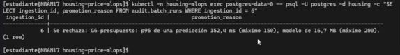

*`promotion_reason` del ingreso 6: la v5 se rechaza por G6, p95 de 152,4 ms (máximo 150) con un modelo de 16,7 MB.*

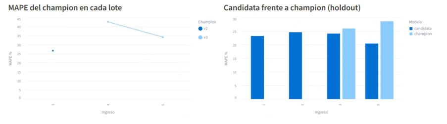

*Streamlit, ciclo 1: MAPE del champion sobre cada lote nuevo antes de entrenar (v2 y v3) y MAPE de holdout de cada candidata frente al champion de ese momento (ingresos 1, 2, 3 y 5).*

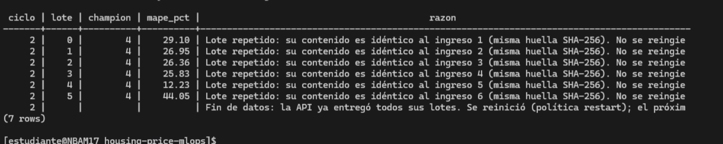

*Monitoreo en el ciclo 2: MAPE del champion v4 sobre el holdout de cada lote repetido (29,1 %, 27,0 %, 26,4 %, 25,8 %, 12,2 % y 44,1 %), con la razón registrada ("Lote repetido: su contenido es idéntico al ingreso 1 (misma huella SHA-256)") y el fin de datos con reinicio.*

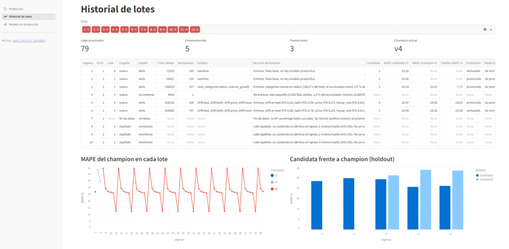

*Historial con los 12 ciclos al 23 de noviembre: 79 ingresos, 5 entrenamientos, 3 promociones y champion v4. La gráfica de la izquierda repite el mismo patrón en cada ciclo de repetidos: el monitoreo del champion es estable.*

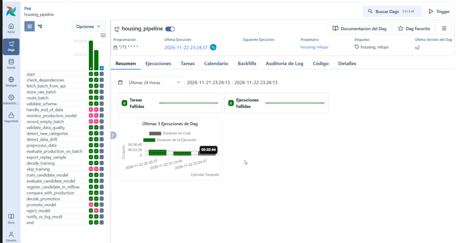

*Grilla de Airflow al despausar el DAG: el lote 0 por la rama `reject_model`, la corrida de las 23:15 con el lote 1 por `promote_model` y la siguiente en curso.*

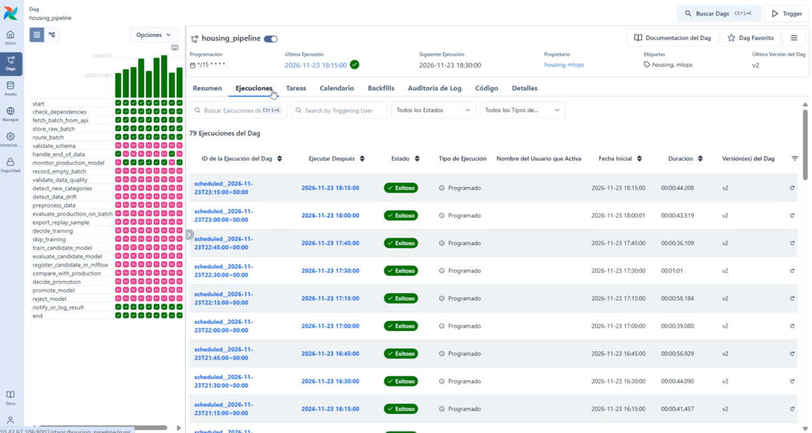

*79 corridas programadas cada 15 minutos, todas exitosas, el 23 de noviembre a las 18:15. La grilla de la izquierda muestra las ramas: las corridas de repetidos pasan por `monitor_production_model` y omiten validación y entrenamiento; las de fin de datos, por `handle_end_of_data`.*

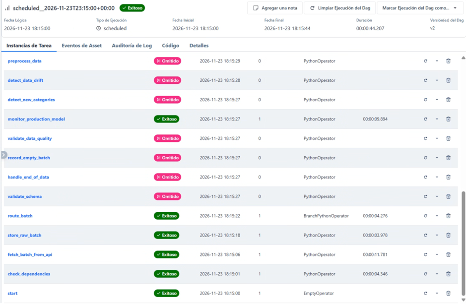

*Una corrida de lote repetido: `route_batch` elige `monitor_production_model`; validación, fin de datos y lote vacío quedan omitidos.*

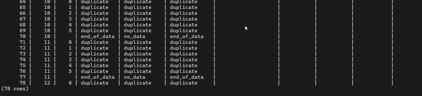

*`audit.batch_runs` hasta el ingreso 78 (ciclo 12): cada ciclo son 6 repetidos y un fin de datos. El pipeline nunca deja de leer.*

## 8. MLflow

- **Servidor:** MLflow 3.16 con su propio PostgreSQL y artefactos en MinIO, servidos por el mismo MLflow (`--serve-artifacts`): Airflow y la API no necesitan credenciales de MinIO.
- **Experimento** `housing-price` y **modelo registrado** `housing-price-model`. Cada run se llama `c<ciclo>-b<lote>-<fecha>`.
- **Tags de cada run:** `ingestion_id`, `api_batch_number`, `cycle`, `batches_used`, `data_sha256`, `train_rows`, `git_sha` (el commit de la imagen de Airflow, que el CI hornea como variable), `preprocessing_version`, `dag_run_id`, `training_reason`, `training_signals`, `promotion_decision` y `promotion_reason`.
- **Parámetros:** hiperparámetros, umbrales de decisión, de promoción y de calidad.
- **Métricas:** MAPE, MdAPE, MAE, RMSE y R² en train, val, test y holdout; las del champion en el mismo holdout; las compuertas (0 o 1); latencia p95, tamaño del modelo, filas y segundos de entrenamiento.
- **Artefactos:** predicho frente a real, residuos y error por banda de precio; SHAP (beeswarm, importancia y dependencia de `house_size` sobre 2.000 filas); `gates.json`; reportes de validación y drift.
- **Modelo:** `mlflow.sklearn` con serialización skops y una lista explícita de tipos confiables (nuestras dos clases y el predictor de árboles de scikit-learn), firma y dependencias fijas. Las versiones nunca se borran.

### Buckets, usuarios y políticas de MinIO

El Job `minio-setup` (`minio/k8s/job-setup.yaml`, un hook PostSync de Argo CD que se puede repetir sin efectos) corre `minio/setup.sh` con la cuenta raíz de MinIO: crea los buckets y un usuario por cliente, cada uno con una política de mínimo privilegio (`minio/policies/`). Las claves salen de los Secrets `minio-root`, `minio-mlflow`, `minio-airflow` y `minio-locust`, creados con `scripts/create_secrets.sh`; ninguna está en el repositorio.

| Usuario | Política | Permisos |
|---|---|---|
| `mlflow` | `mlflow-artifacts` | Leer, escribir y borrar en `mlflow` (artefactos de los runs) |
| `airflow` | `airflow-data` | Leer, escribir y borrar en `landing` (respuestas crudas de la API) y `datasets` (archivos de trabajo y muestra de replay) |
| `locust` | `locust-replay` | Solo leer los objetos de `datasets/replay/`; ni siquiera puede listar el bucket |

Airflow y la API no necesitan credenciales de MinIO para los modelos: MLflow sirve los artefactos como proxy.

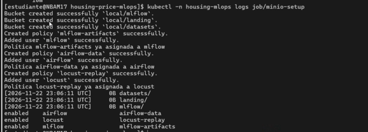

*Log del Job `minio-setup` en el clúster: crea los buckets `mlflow`, `landing` y `datasets`, las políticas `mlflow-artifacts`, `airflow-data` y `locust-replay`, y los usuarios `mlflow`, `airflow` y `locust`, cada uno con su política.*

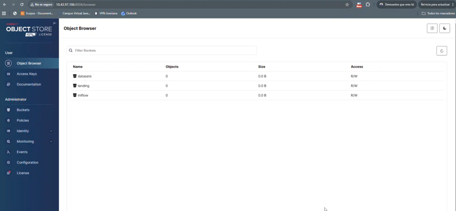

*Consola de MinIO (`:8004`) recién creada la plataforma: los 3 buckets, todavía vacíos.*

Dos detalles que costaron tiempo y quedaron documentados en el código: la validación automática de MLflow con `input_example` cargaba el modelo una y otra vez y no terminaba, así que se registra solo la firma; y los clientes necesitan `MLFLOW_ENABLE_PROXY_MULTIPART_DOWNLOAD=false`, porque si no piden URLs prefirmadas y bajan los artefactos directo de MinIO, saltándose el proxy.

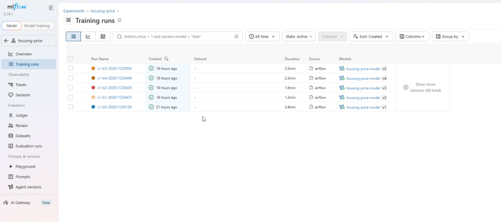

*Experimento `housing-price` en el clúster: un run por entrenamiento (`c1-b0` a `c1-b5`) con su versión registrada de `housing-price-model` (v1 a v5), todos creados por Airflow.*

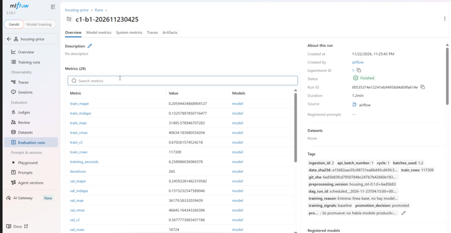

*Run `c1-b1` (versión 2): 29 métricas y los tags de trazabilidad: ingreso 2, lote 1, ciclo 1, lotes usados 1 y 2, huella de los datos, commit `6ad5b83` de la imagen, corrida de Airflow, razón del entrenamiento (línea base) y de la promoción.*

El modelo productivo se identifica por alias en el registro: la API lo resuelve como `housing-price-model@champion`. La página "Modelo en producción" de Streamlit ([sección 10](#10-streamlit)) lee esos alias directamente del registro de MLflow y muestra a qué versión apunta cada uno, con su ingreso, lote, MAPE de holdout, decisión y commit.
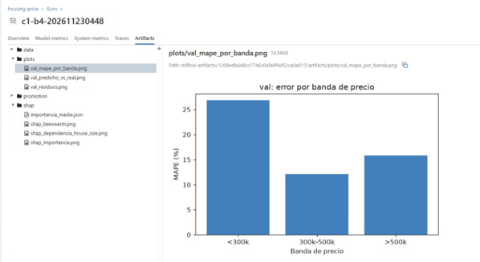

*Artefacto `plots/val_mape_por_banda.png` del run `c1-b4`: MAPE de validación por banda de precio, ~27 % por debajo de 300 mil USD, ~12 % entre 300 y 500 mil y ~16 % por encima. Es el diagnóstico por banda que se registra pero no bloquea la promoción.*

## 9. Inferencia

| Endpoint | Uso |
|---|---|
| `POST /predict` | Valida la entrada con los mismos rangos del pipeline y responde precio, versión, alias y `request_id`. Header opcional `X-Traffic-Source` |
| `POST /explain` | Contribuciones SHAP de una predicción, como efecto sobre el precio |
| `POST /feedback` | Precio real de una predicción anterior, por `request_id` |
| `GET /model-info` | Champion y sombra cargados: versión, run, métricas, hora de carga, réplica y fracción de sombra |
| `POST /admin/reload`, `POST /admin/rollback` | Revisión inmediata de alias y vuelta al modelo anterior; requieren el token del Secret `api-admin` |
| `GET /health`, `GET /metrics`, `GET /docs` | Salud, métricas de Prometheus y Swagger |

**Recarga sin redespliegue.** La API nunca tiene una versión escrita en el código: resuelve `housing-price-model@champion` en MLflow. Un hilo revisa los alias cada 30 segundos y, si la versión cambió, descarga el modelo nuevo fuera del lock y lo reemplaza en un solo paso. Si la descarga falla, sigue sirviendo el anterior y cuenta el fallo. Cada recarga queda en `audit.model_actions` con la réplica que la hizo. Como el cambio está en MLflow y no en Kubernetes, las réplicas convergen solas.

**Modo sombra.** Si `challenger` apunta a una versión distinta del champion, la API también la carga y, después de responder, la hace predecir sobre la misma entrada. Las dos predicciones y sus latencias quedan en el mismo evento. Desde el PR #25 la sombra corre en el 20 % del tráfico en vivo y en todo el tráfico de replay, que es el que tiene precio real.

**Rollback.** `/admin/rollback` mueve `champion` a la versión de `previous_champion`, deja la retirada como `previous_champion` (se puede deshacer) y lo registra. Se probó en el entorno de Docker (de la versión 5 a la 4 y de vuelta); en el clúster no hizo falta usarlo.

**Registro de inferencias.** Cada petición, también las rechazadas (422) y las que llegan sin modelo (503), va a una cola en memoria que un hilo escribe por lotes en `raw.inference_events`. La latencia de PostgreSQL no se suma a la respuesta y, si la base falla, la predicción no falla.

**Rendimiento.** Un worker y un hilo por réplica (`OMP_NUM_THREADS=1`), por la medición de la sección 2. Las réplicas las maneja un autoescalado ([sección 13](#13-observabilidad-y-prueba-de-carga)).

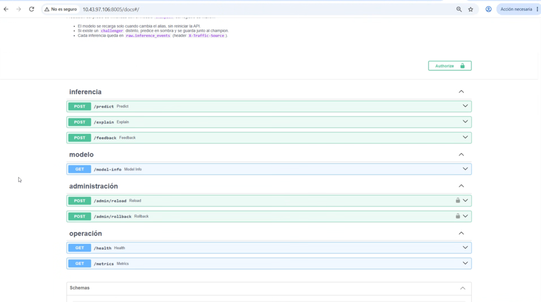

*Swagger de la API en el clúster (`:8005/docs`): inferencia, modelo, administración (con candado) y operación.*

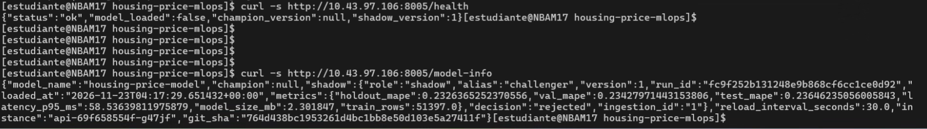

*Antes del primer champion: `/health` responde con `model_loaded: false` y `/model-info` muestra la versión 1 como challenger rechazado (G6, 58,5 ms).*

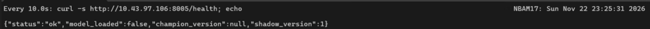

*`/health` a las 23:25:31 del 22 de noviembre: sin champion.*

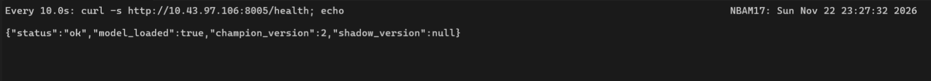

*Dos minutos después, a las 23:27:32: `model_loaded: true` y `champion_version: 2`, sin reiniciar los pods.*

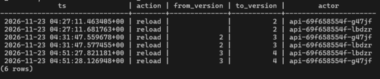

*`audit.model_actions`: 6 recargas, la versión 2, la 3 y la 4 en cada una de las dos réplicas (`api-69f658554f-g47jf` y `api-69f658554f-lbdzr`). Los nombres de los pods no cambian entre versiones: es el mismo pod cargando el modelo nuevo.*

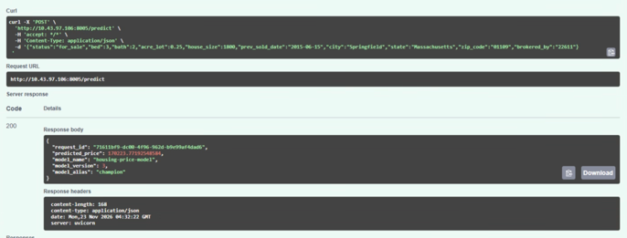

*`POST /predict` desde Swagger: 170.223,77 USD con `housing-price-model` versión 2, alias `champion`.*

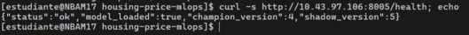

*Después del ciclo 1: champion v4 y sombra v5, el candidato rechazado que sigue como challenger.*

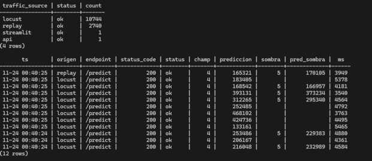

*`raw.inference_events`: eventos por origen (10.744 de Locust, 2.740 de replay, 1 de Streamlit y 1 de un cliente, todos `ok`) y las últimas 12 filas, de la segunda prueba de carga: hora, origen, endpoint, código, estado, versión del champion (4), predicción, versión y predicción de la sombra (5, solo en una parte del tráfico) y latencia del champion, que con la réplica saturada sube a 3,5-5,4 s porque cada predicción espera CPU.*

## 10. Streamlit

La interfaz (`:8007`) nunca carga el modelo: todas las predicciones pasan por la API, así el usuario ve exactamente lo que sirve producción y su uso queda registrado (`X-Traffic-Source: streamlit`) para la señal de drift de inferencias. La base la lee con el rol `app_reader`, de solo lectura.

| Página | Qué muestra |
|---|---|
| Predicción | Formulario, precio estimado con versión y alias, explicación SHAP en cascada y envío del precio real |
| Historial de lotes | Indicadores, tabla de cada ingreso con señales, razones, MAPE y enlace a MLflow; gráficas de MAPE; detalle de esquema, calidad, categorías nuevas, drift y compuertas |
| Modelo en producción | Versiones que sirve la API, alias de MLflow con su MAPE de holdout y últimas recargas y rollbacks |

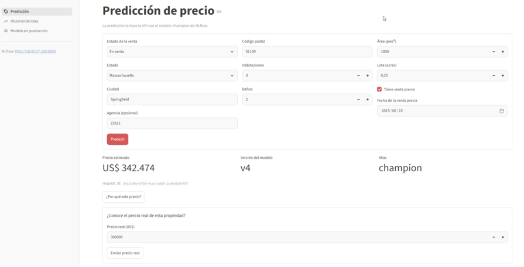

*Predicción de 342.474 USD con el modelo v4, alias `champion`, y su `request_id`.*

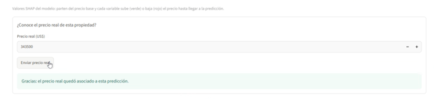

*Envío del precio real de esa predicción.*

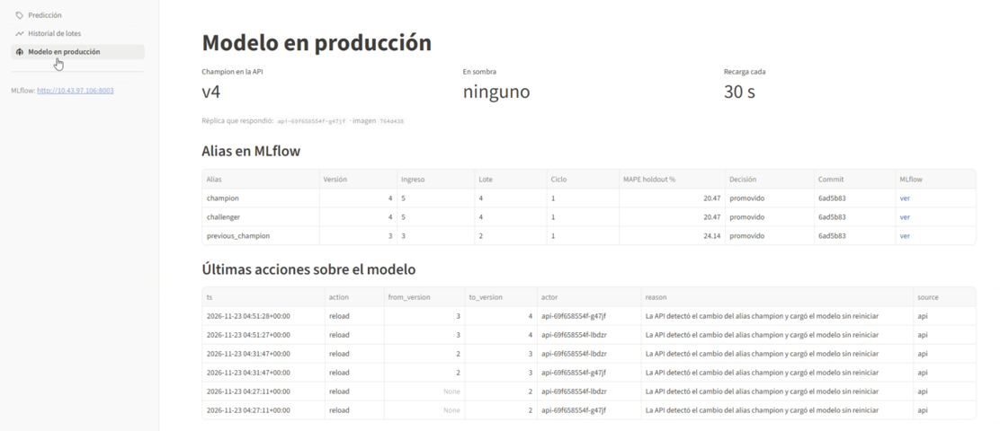

*Modelo en producción: champion v4 en la API, alias en MLflow (`champion` y `challenger` en v4, `previous_champion` en v3, antes de que la v5 quedara como challenger) y las recargas de cada réplica a las versiones 2, 3 y 4 (04:27, 04:31 y 04:51 UTC).*

La tabla y las gráficas del historial están en las secciones [4](#4-validación-y-decisión-de-entrenamiento) y [7](#7-análisis-por-lote); la explicación SHAP, en la [5](#5-modelo-métrica-y-promoción).

## 11. CI/CD y GitOps

| Workflow | Cuándo | Qué hace |
|---|---|---|
| `ci.yml` | Cada PR y push a `master` | `ruff check`, `ruff format --check` y `pytest` (89 pruebas); renderiza cada `kustomization` y el chart de Airflow con nuestros valores y los valida con `kubeconform`; verifica que existan las rutas de las apps de Argo |
| `build-airflow.yml`, `build-api.yml`, `build-streamlit.yml`, `build-mlflow.yml` | Push a `master` (y PR, sin publicar) que toca los archivos de su imagen | Llaman a `_build-push.yml` |
| `_build-push.yml` | Reutilizable | Construye `linux/amd64` con el commit como `GIT_SHA`, publica `crissebasbol/housing-<componente>:sha-<7>` en DockerHub y, con una deploy key, hace un commit `Imagen <componente> sha-<7> [skip ci]` que cambia el tag en el manifiesto |

Argo CD instala una sola app a mano, `housing-root` (patrón *app-of-apps*), que crea las demás desde `argocd/apps/`: `data-platform` (bases, MinIO, MLflow y API de datos), `airflow` (chart oficial con nuestros valores), `serving` (API y Streamlit) y `observability` (Prometheus, Grafana y Locust), todas con `prune` y `selfHeal`. El ciclo completo de un cambio: merge a `master`, build y push de la imagen, commit del bot con el tag nuevo, Argo detecta el commit y sincroniza. Nadie aplica manifiestos a mano ni sube imágenes desde su máquina.

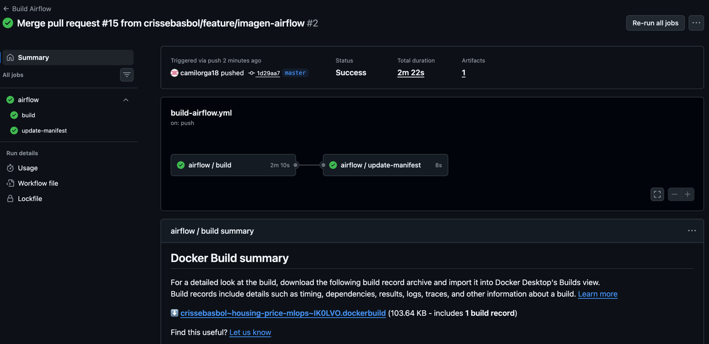

*`Build Airflow` sobre el merge del PR #15: build (2m 10s) y actualización del manifiesto (8 s) en verde.*

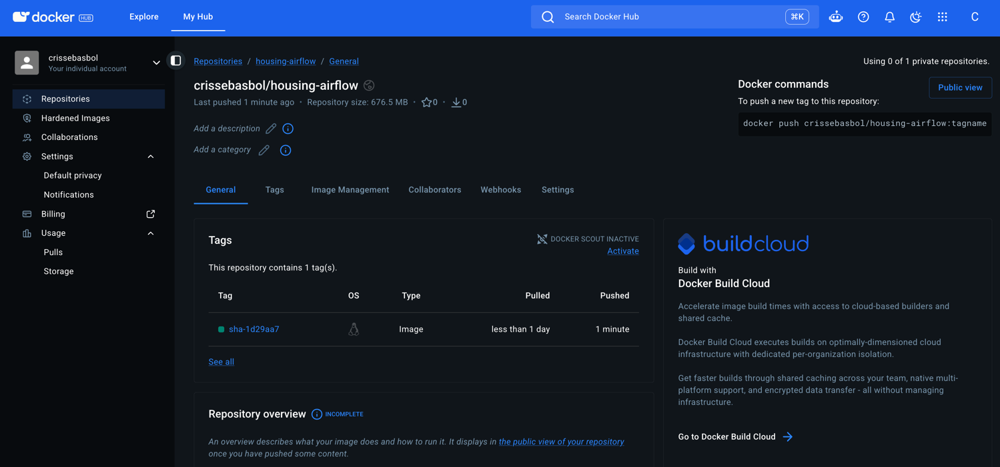

*DockerHub: `crissebasbol/housing-airflow` con el tag `sha-1d29aa7`, el commit del merge.*

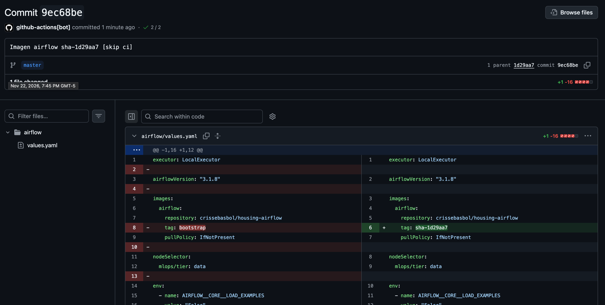

*Commit de `github-actions[bot]`: `airflow/values.yaml` pasa de `tag: bootstrap` a `tag: sha-1d29aa7`.*

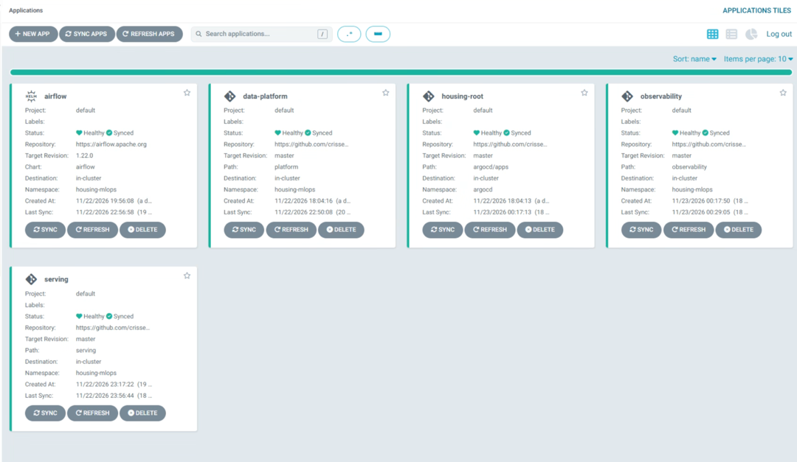

*Las 5 apps de Argo CD en Healthy y Synced, con su repositorio, ruta y última sincronización.*

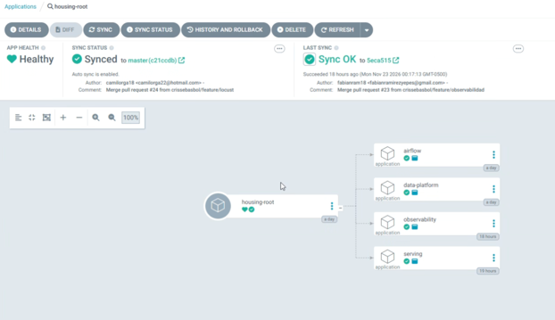

*`housing-root` con sus 4 apps hijas. La última sincronización corresponde al merge del PR #23, que agregó `observability`.*

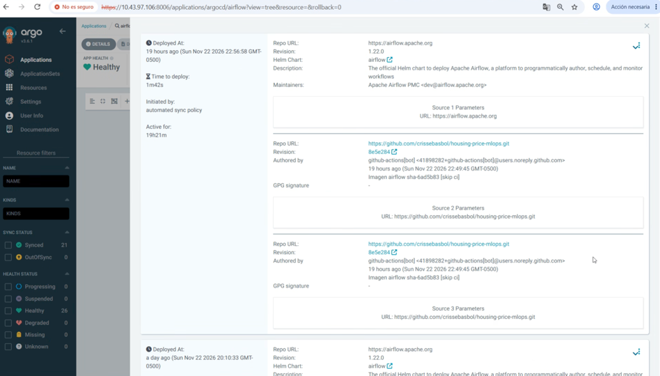

*History de `airflow`: sincronización automática con el commit del bot `8e5e284` (`Imagen airflow sha-6ad5b83`), con el chart 1.22.0, los valores y `airflow/k8s` como fuentes.*

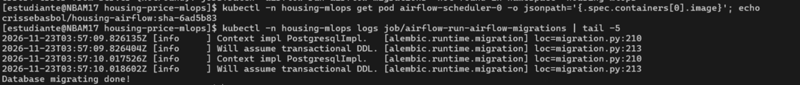

*Resultado de esa sincronización: el scheduler corre `housing-airflow:sha-6ad5b83` y el Job de migraciones terminó (`Database migrating done!`).*

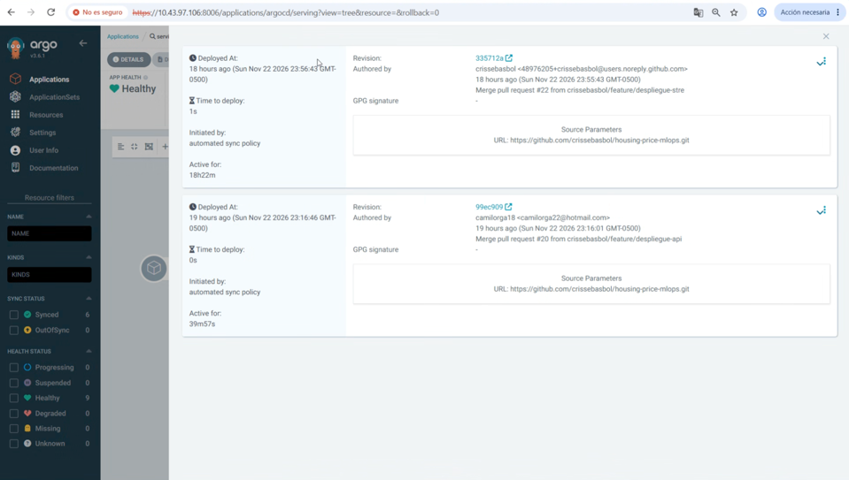

*History de `serving`: las sincronizaciones de los merges #20 (API) y #22 (Streamlit).*

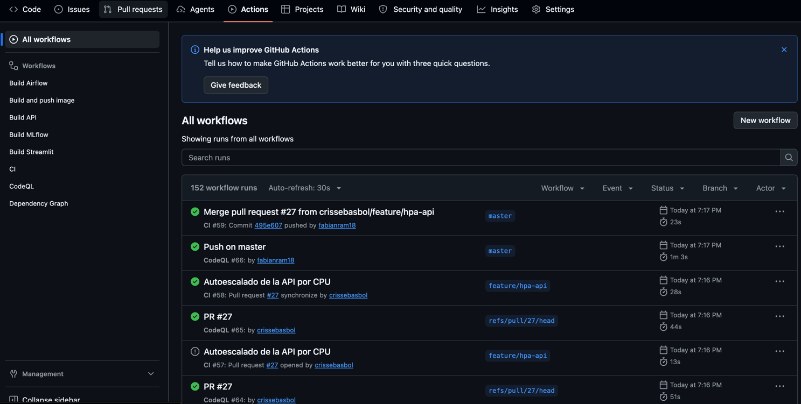

*GitHub Actions: 152 corridas de los workflows del repositorio (CI, builds de cada imagen y CodeQL); las últimas, del PR #27 y su merge, en verde.*

## 12. Kubernetes

Clúster RKE2 v1.36.6 creado con Rancher; todo el proyecto vive en el namespace `housing-mlops`, que Argo no puede borrar (`Prune=false,Delete=false`). Un `LimitRange` da recursos por defecto a los contenedores que no los declaran (por ejemplo, los *init containers* del chart de Airflow).

| Contenedor | Nodo | Requests (CPU / memoria) | Limits | Probes | Volumen |
|---|---|---|---|---|---|
| API de datos | data | 100m / 512Mi | 1 / 1536Mi | readiness y liveness | 100Mi |
| PostgreSQL de datos | data | 250m / 1Gi | 1 / 2Gi | `pg_isready` | 20Gi |
| PostgreSQL de MLflow y de Airflow | data | 100m / 256Mi | 500m / 512Mi | `pg_isready` | 2Gi cada uno |
| MinIO | data | 100m / 256Mi | 1 / 1Gi | readiness y liveness | 20Gi |
| MLflow | data | 250m / 768Mi | 1 / 2Gi | `/health` | - |
| Airflow scheduler (corre las tareas) | data | 500m / 2Gi | 2 / 4Gi | las del chart | logs 5Gi |
| Airflow api-server, dag-processor, triggerer | data | 250m, 100m y 50m | 1, 1 y 500m | las del chart | - |
| Locust | data | 200m / 256Mi | 1 / 1Gi | readiness y liveness | - |
| API de inferencia (HPA, 2 a 3) | serving | 500m / 768Mi | 1 / 1536Mi | `/health` (5 y 10 s de timeout) | - |
| Streamlit | serving | 100m / 256Mi | 500m / 768Mi | `/_stcore/health` | - |
| Prometheus | serving | 100m / 256Mi | 1 / 1Gi | readiness y liveness | 5Gi |
| Grafana | serving | 100m / 192Mi | 500m / 512Mi | readiness y liveness | 1Gi |

Los valores salen de mediciones, no de supuestos: el scheduler de Airflow con el pico de memoria del entrenamiento (1,0 GiB), MLflow sin los procesos de GenAI, la API con la prueba de carga. Los datos persisten en volúmenes `local-path` en `/opt`, separados de `/var` donde viven las imágenes.

**Secrets.** Ninguna contraseña está en el repositorio. `scripts/create_secrets.sh` crea los Secrets desde un `.env` local (con `.env.example` como plantilla) y se niega a correr si el contexto de `kubectl` no es el del clúster del proyecto. Los manifiestos solo los referencian.

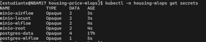

*Los 6 Secrets de la plataforma de datos el 22 de noviembre, creados con `create_secrets.sh` (solo nombres, tipo y número de claves). Después el mismo script agregó los de Airflow, la API y Grafana.*

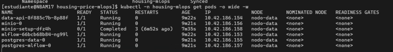

*La plataforma de datos en `nodo-data`: API de datos, MinIO, MLflow y las dos bases en Running; el Job `minio-setup` completado.*


*Job `minio-setup` completo y 4 volúmenes `Bound` en `local-path` (20Gi, 20Gi, 2Gi y 100Mi).*


*Las réplicas de la API con 0 reinicios después de la primera prueba de carga con 100 usuarios.*


*Los dos nodos en Ready y todos los pods de `housing-mlops` con su nodo, estado, requests y limits de CPU y memoria: Airflow, la plataforma de datos y Locust en `nodo-data`; la API (2 réplicas), Streamlit, Prometheus y Grafana en `nodo-serving`; los Jobs de migraciones, usuario y MinIO en `Succeeded`.*

## 13. Observabilidad y prueba de carga

### Qué se mide

- **Prometheus** descubre los pods de la API con `kubernetes_sd` (cada 5 s) y scrapea también la API de datos, el cAdvisor del kubelet de cada nodo (CPU, memoria y throttling por contenedor) y a sí mismo.
- **La API** expone peticiones por endpoint y código, latencia, peticiones en curso, predicciones y latencia del modelo por rol (champion o sombra), versión cargada, recargas y fallos, diferencia entre sombra y champion, categorías desconocidas y la escritura del registro de inferencias.
- **Grafana** carga el dashboard "Housing API" desde un ConfigMap del repositorio, con fuentes Prometheus y PostgreSQL (rol `app_reader`). Tiene seis filas: resumen, tráfico y latencia, modelo, registro de inferencias, recursos de los pods (con los pods en ejecución y los que responden) y replay (MAPE en línea de champion y sombra contra el precio real de filas del holdout).
- **Locust** corre en `nodo-data` con dos tipos de usuario: `PredictUser` (peso 4) envía propiedades de la muestra de replay como tráfico normal, y `ReplayUser` (peso 1) envía filas del holdout con su `row_hash`, para medir el error en línea. Esperan entre 0,5 y 1,5 s entre peticiones. La muestra de 5.000 filas la escribe el DAG en MinIO y Locust la lee con un usuario de solo lectura. `locust/run_levels.sh` corre escalones de usuarios (3 minutos estables cada uno) y guarda las estadísticas, `kubectl top` y las réplicas observadas.


*Dashboard "Housing API" en reposo: champion v4, 2 réplicas, 0 % de errores.*


*El pod de Locust en `nodo-data`: el *init container* descargó la muestra de replay con el usuario `locust` de MinIO y Locust cargó las 5.000 filas.*


*Prometheus (`:8009`): los 6 targets en UP. Las 2 réplicas de la API (descubiertas por `kubernetes_sd`, con su pod y nodo como etiquetas), la API de datos, el cAdvisor de los dos nodos y Prometheus.*

### Primera señal: una prueba manual

Con la UI de Locust lanzamos 100 usuarios mientras la API corría el champion y la sombra en cada predicción. Respondió unos 6 RPS con una mediana de 15 s, sin fallos: la API estaba saturada.


*Prueba manual (100 usuarios, sombra en el 100 % de las predicciones): ~6 RPS, p50 de 15 s y p95 de 18 s, 0 % de fallos.*


*Grafana durante esa prueba: la latencia de `/predict` llega al tope del histograma (5 s), hasta 40 peticiones en curso por réplica y una réplica que deja de contestar el scrape.*

Con esa evidencia cambiamos dos cosas antes de medir con método (PR #25): la sombra pasa a correr solo en el 20 % del tráfico en vivo (el replay siempre), y las sondas de salud de la API tienen 5 y 10 s de timeout, para que una réplica saturada no salga del Service ni se reinicie.

### Primera prueba: 2 réplicas fijas

`run_levels.sh 10 25 50 100`, sombra en el 20 %, 2 réplicas de 1 CPU:

| Usuarios | RPS | p50 | p95 | p99 | Fallos |
|---|---|---|---|---|---|
| 10 | 7,5 | 300 ms | 670 ms | 830 ms | 0 |
| 25 | 8,3 | 2,1 s | 3,5 s | 4,0 s | 0 |
| 50 | 8,1 | 4,8 s | 8,1 s | 9,3 s | 0 |
| 100 | 7,9 | 11 s | 15 s | 16 s | 0 |


*`resumen.csv` de la primera prueba: el throughput se queda en ~8 RPS en todos los escalones.*


*Los 4 escalones en Grafana: ~8 RPS en meseta (~4 por réplica) mientras la latencia sube escalón por escalón.*


*cAdvisor: la CPU de cada réplica pegada a su límite de 1 core y throttling de hasta ~19 %; la memoria estable en ~530 Mi; el registro de inferencias sin eventos perdidos.*


*Replay: la sombra v5 con ~20 % de MAPE frente a ~25-30 % del champion v4, sobre filas del holdout con su precio real.*

**Lectura.** Desde 25 usuarios el throughput deja de crecer: cada usuario adicional solo agrega espera en la cola. Con 100 usuarios a 7,9 RPS, cada petición espera unos 100 / 7,9 ≈ 12,7 s (ley de Little), cerca de la mediana medida (11 s). El cuello de botella es la CPU: cada predicción cuesta unos 250 ms de CPU en estos nodos (el pipeline del modelo procesa la fila con pandas y, en un tercio de las peticiones, corre también la sombra). Con 1 CPU por réplica, eso da ~4 RPS por réplica.

### Segunda prueba: autoescalado de 2 a 3 réplicas

Si la API escala con réplicas, lo que corresponde es dejar que Kubernetes las agregue. El PR #27 agregó un `HorizontalPodAutoscaler` (2 a 3 réplicas, objetivo de CPU al 70 % de lo pedido) y quitó `replicas` del Deployment para que Argo no deshaga lo que decide el HPA. El máximo es 3 porque `nodo-serving` tiene 4 CPU y también corre Prometheus, Grafana y Streamlit. Repetimos los mismos escalones:

| Usuarios | 2 réplicas fijas (RPS / p50 / p95) | HPA, 3 réplicas (RPS / p50 / p95) | Cambio en RPS |
|---|---|---|---|
| 10 | 7,5 / 300 ms / 670 ms | 7,0 / 380 ms / 910 ms | igual |
| 25 | 8,3 / 2,1 s / 3,5 s | 11,1 / 1,2 s / 2,1 s | +34 % |
| 50 | 8,1 / 4,8 s / 8,1 s | 10,7 / 3,6 s / 6,5 s | +32 % |
| 100 | 7,9 / 11 s / 15 s | 10,0 / 8,7 s / 12 s | +27 % |


*`kubectl get hpa api -w` durante la prueba: la CPU llega a 160 % de lo pedido, el HPA mantiene 3 réplicas toda la carga y vuelve a 2 tres minutos después de terminar.*


*Grafana al empezar la segunda prueba: "Pods de la API" en 3 y el tráfico repartido entre las réplicas.*


*`resumen.csv` con las dos pruebas: la columna `replicas` registra los pods observados en cada escalón.*


*Fin de la segunda prueba: el HPA con 3 réplicas, `kubectl top` de los 3 pods (547 a 571 Mi) y los eventos de escalado (a 3 por CPU sobre el objetivo).*


*La última hora en Grafana: ~8 RPS con 2 réplicas a la izquierda y ~11 RPS con 3 a la derecha, con la tercera réplica en la gráfica por réplica y latencias más bajas.*


*Recursos en las dos pruebas: con 3 réplicas cada una usa ~0,85 cores en vez de 1. El panel de pods muestra la tercera réplica durante la segunda prueba y la vuelta a 2.*

### Conclusiones sobre los recursos

- **La API escala con réplicas, no con usuarios.** El throughput de una configuración es fijo; más usuarios solo agregan cola.
- **Escalar ayuda menos que en proporción.** Con 50 % más pods hubo ~30 % más throughput: cada réplica pasó de 1 core a ~0,85 porque las 3 comparten los 4 CPU de `nodo-serving` con la observabilidad.
- **Con poca demanda la tercera réplica no aporta.** Con 10 usuarios (~7 RPS) bastaban 2; el arranque de la tercera subió un poco la latencia.
- **No hubo fallos ni reinicios** en ninguna prueba, y la memoria se mantuvo estable en ~550 Mi por réplica: el límite de 1,5 Gi sobra y el request de 768 Mi se podría bajar.
- **El objetivo de p95 menor a 500 ms no se cumple** ni con 10 usuarios. El límite real es el costo de CPU por predicción, y es la misma tensión que hizo rechazar la versión 5 por latencia.

**Qué haríamos con más tiempo o más nodos:**

1. Abaratar cada predicción: no transformar dos veces la fila (hoy la API la vuelve a transformar para contar categorías desconocidas) y reducir el trabajo de pandas por fila.
2. Limitar la complejidad del modelo al entrenar (menos iteraciones o árboles más pequeños), para que los candidatos quepan en el presupuesto de G6.
3. Llevar Prometheus y Grafana a otro nodo y subir el máximo del HPA.
4. Mover la sombra a un proceso aparte, para que no compita por la CPU de la respuesta.

## 14. Lo que no se hizo y por qué

| Tema | Estado | Por qué |
|---|---|---|
| Canary, pruebas A/B, Argo Rollouts | No se hizo | Sin usuarios reales el tráfico dividido no es significativo; la sombra compara champion y challenger sobre el mismo tráfico sin afectar la respuesta |
| Promoción manual | Solo como operación | La promoción la decide el pipeline con reglas explícitas; los endpoints de recarga y rollback quedan para operar |
| Rollback en el clúster | Probado solo en Docker | Funciona (de la versión 5 a la 4 y de vuelta), pero en el clúster ninguna promoción lo necesitó |
| Señal de drift de inferencias | Implementada, nunca se activó | Excluye a propósito el tráfico de Locust y el de replay; el tráfico real (Streamlit) no llegó a los 500 eventos que exige |
| Feedback de usuarios | Implementado como complemento | Casi no hay feedback real; la etiqueta llega con los lotes siguientes, que son la evaluación principal |
| Métricas de estado de Kubernetes (kube-state-metrics) | No se instaló | El panel de pods usa cAdvisor, que ya se scrapeaba; las réplicas que decide el HPA se ven con `kubectl get hpa` |
| p95 menor a 500 ms bajo carga | No se alcanzó | Ver las conclusiones de la sección 13 |

**Lo que aprendimos de lo que salió mal:**

- **Medir donde se va a correr.** El presupuesto de latencia calibrado en un portátil rechazó la primera línea base en el clúster. Desde entonces cada número que fija un recurso (latencia, memoria de Airflow, CPU de la API) salió de una medición en el entorno real.
- **Los valores por defecto también cuestan.** MLflow 3.16 levantaba procesos que no usábamos y se quedaba sin memoria; el `/var` de 15 GB se llenó con imágenes aunque el disco tenía 150 GB.
- **Un PR verde no es un despliegue verde.** En el PR #16 faltó una carpeta y la CI pasó, pero Argo no podía sincronizar. Agregamos a la CI una verificación de que existan las rutas de cada app de Argo.
- **Git guarda permisos.** Dos scripts se subieron sin el bit de ejecución y fallaron en el clúster; se corrigió con `git update-index --chmod=+x`.

## 15. Cómo reproducir

**Desarrollo local** (Python 3.12 con [uv](https://docs.astral.sh/uv/)):

```bash
uv sync
uv run ruff check . && uv run pytest                      # 89 pruebas
uv run python scripts/fetch_batches.py --api-url http://localhost:8089 --out data/batches   # API de datos en Docker
uv run python scripts/simulate_batches.py --batches-dir data/batches --out data/simulation
```

**Clúster** (detalle en [`cluster/README.md`](cluster/README.md) y [`argocd/README.md`](argocd/README.md)):

1. Preparar los nodos, instalar Rancher y crear el clúster RKE2 desde su interfaz (`cluster/prepare_node.sh`, `cluster/install_rancher.sh`).
2. `KUBE_CONTEXT=housing ./cluster/bootstrap.sh`: StorageClass `local-path`, etiquetas `mlops/tier` y Argo CD.
3. `cp .env.example .env`, completar los valores y `./scripts/create_secrets.sh`.
4. `kubectl apply -n argocd -f argocd/root.yaml`: Argo despliega todo lo demás desde `master`.
5. `./scripts/port_forward.sh start` en la VM de entrada para publicar las interfaces (puertos de la sección 1).
6. Despausar el DAG `housing_pipeline` en Airflow. Está pausado al crearse para no consumir lotes antes de tiempo.

## 16. Equipo

El trabajo se dividió en 27 PRs con revisión cruzada (CODEOWNERS pide la aprobación de otro integrante) y fusión con *merge commit*.

| Integrante | Usuario | PRs |
|---|---|---|
| Cristhian Bolaños | `crissebasbol` | Plantillas del repo (#1), esquema y calidad (#2), modelo y compuertas (#5), CI y build de MLflow (#11), DAG de Airflow (#14), ajustes tras el primer despliegue (#18), Streamlit (#21, #22), capacidad de la API y autoescalado (#25, #27), arreglos (#9, #13, #26) |
| Cristian Organista | `camilorga18` | Drift y decisión de entrenamiento (#4), base de datos (#6), scripts del clúster (#8), apps de Argo CD (#12), imagen y despliegue de Airflow (#15, #16, #17), despliegue de la API (#20), Locust (#24) |
| Fabián Ramírez | `fabianram18` | Features y split (#3), simulación offline (#7), plataforma de datos (#10), API de inferencia (#19), Prometheus y Grafana (#23) |

Licencia [MIT](LICENSE).
